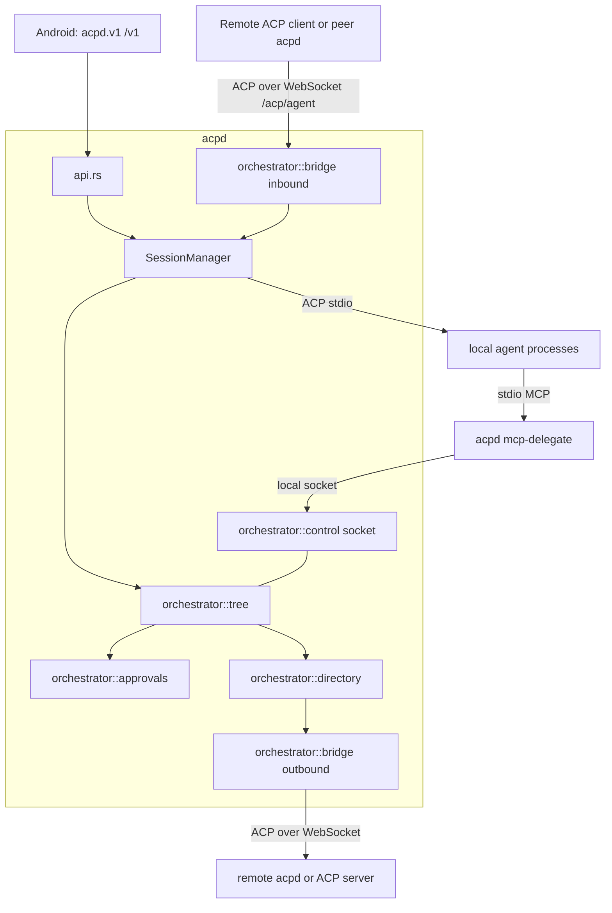

# Agent orchestrator specification (acpd module)

Status: design specification, 13 October 2026. Nothing here is implemented. It does not change the paused acceptance gates in [TODO.md](../TODO.md). "Verified" below means read in a primary source or in this repository on that date; everything else is a proposal.

## 1. Goal and decisions

Let ACP agents, local or on other hosts, be discovered, launched, supervised and delegated to by one another, with no second remote-shell transport and no change to how the phone works today.

Decided by the user:

1. Remote agents are in scope.
2. A **supervisor agent** may approve a child's permission request when it judges it safe, and escalates to the phone when not. Default ceiling `medium`; `high` always goes to the phone.
3. No separate reviewer model. The supervising agent decides; anything unanswered goes to the phone.
4. The orchestrator is a module inside `acpd`.
5. Host-to-host links use the standard ACP **`/acp` endpoint** built into the server (the bridge), not `acpd.v1`.
6. Support nearly all ACP agent CLIs, so the design assumes baseline ACP over stdio only.
7. Prompt injection between strong models is accepted as a residual risk; cheap deterministic checks stay (section 8).

Non-goals for the first release: A2A interoperability, a hosted relay, agent-to-agent traffic that bypasses the host, automatic prompt retries, Android UI.

## 2. Verified findings from official sources

Most facts below were read from the source repositories on GitHub (`main`) while `agentclientprotocol.com` was blocked by this environment's egress policy. The docs site and registry CDN became reachable later (the registry index was read from the CDN); statuses should still be re-checked on the live site before building.

| Topic | Verified fact | Source |
| --- | --- | --- |
| Remote transport | RFD "Streamable HTTP & WebSocket Transport", **Active** on the live RFD index (moved to Active 2026-07-02; a "v2" follow-up is listed separately). One `/acp` endpoint. `POST` for client→server (always `202`, except `initialize` which returns `200` + JSON), long-lived SSE `GET` streams (one per connection plus one per session), HTTP/2 required, `Acp-Connection-Id` / `Acp-Session-Id` headers. A `GET` with `Upgrade: websocket` upgrades; the `101` response carries `Acp-Connection-Id`; messages are JSON-RPC **text frames** (binary ignored); the client must still send `initialize` first. Clients MUST support both; servers MAY offer WebSocket only. Cookies required for affinity. Batches return `501`. `DELETE` ends a connection. | [RFD](https://github.com/agentclientprotocol/agent-client-protocol/blob/main/docs/rfds/streamable-http-websocket-transport.mdx) |
| v1 durability | Sessions survive disconnects and resume via `session/load`. **No sequencing, no replay of messages missed while disconnected, liveness is the implementer's job.** Message IDs and `Last-Event-ID` resumption are deferred to v2. Phase 4 (origin validation, protocol-version header, security audit) is still future work. | same RFD |
| Authentication on remote | Not defined in the RFD as read. | same RFD |
| Reference implementation | Goose (`block/goose`) is the reference implementation in progress; Rust SDK (`sacp`) next. | same RFD |
| MCP servers | **All agents MUST support MCP servers over stdio.** HTTP and SSE are optional and advertised as `mcpCapabilities.http` / `.sse`. `session/new` takes `cwd` and `mcpServers: [{name, command, args, env}]`. | [session-setup](https://github.com/agentclientprotocol/agent-client-protocol/blob/main/docs/protocol/v1/session-setup.mdx) |
| Permission | `session/request_permission` carries `sessionId`, `toolCall`, `options[{optionId,name,kind}]` with kinds including `allow_once` and `reject_once`; answers are `{"outcome":{"outcome":"selected","optionId":…}}` or `{"outcome":{"outcome":"cancelled"}}` (matches `connection.rs`). Tool kinds: `read`, `edit`, `delete`, `move`, `search`, `execute`, `think`, `fetch`, `switch_mode`, `other`. | [tool-calls](https://github.com/agentclientprotocol/agent-client-protocol/blob/main/docs/protocol/v1/tool-calls.mdx) |
| Cancellation | `session/cancel` ends a prompt turn with stop reason `cancelled`; the client must answer pending permission requests with `cancelled`. `$/cancel_request` is a stabilized, optional request cancel (error `-32800`). | [prompt-turn](https://github.com/agentclientprotocol/agent-client-protocol/blob/main/docs/protocol/v1/prompt-turn.mdx), [RFD](https://github.com/agentclientprotocol/agent-client-protocol/blob/main/docs/rfds/request-cancellation.mdx) |
| Initialization and capabilities | `initialize` carries one integer protocol version (agent answers the same version or its latest; the client should close on a mismatch), `clientCapabilities` (`fs.readTextFile`, `fs.writeTextFile`, `terminal`, `elicitation`, `auth.terminal`, …) and `clientInfo`. Omitted capabilities mean unsupported. Agents answer `agentCapabilities` (`loadSession`, `promptCapabilities`, `mcpCapabilities`, `auth.logout`, `sessionCapabilities`) and `authMethods`. | [initialization](https://github.com/agentclientprotocol/agent-client-protocol/blob/main/docs/protocol/v1/initialization.mdx) |
| Baseline vs optional methods | Every agent MUST support `session/new`, `session/prompt`, `session/cancel`, `session/update`. Optional, each advertised: `session/load` (`loadSession`, replays history), `session/resume` (`sessionCapabilities.resume`, **no replay**), `session/close` (`.close`), `session/list`, `session/delete`, `additionalDirectories`. A client MUST NOT call an unadvertised method. | [initialization](https://github.com/agentclientprotocol/agent-client-protocol/blob/main/docs/protocol/v1/initialization.mdx), [session-setup](https://github.com/agentclientprotocol/agent-client-protocol/blob/main/docs/protocol/v1/session-setup.mdx) |
| Working directory | `cwd` MUST be an absolute path, is used regardless of where the agent was spawned, and is part of the effective root set (`[cwd, …additionalDirectories]`) that SHOULD bound tool file operations. | session-setup |
| Stop reasons | `end_turn`, `max_tokens`, `max_turn_requests`, `refusal`, `cancelled`. | [prompt-turn](https://github.com/agentclientprotocol/agent-client-protocol/blob/main/docs/protocol/v1/prompt-turn.mdx) |
| Usage and cost | Agents MAY send `usage_update` with required `used` and `size` token counts and an optional `cost {amount, currency}` (ISO 4217). | prompt-turn |
| Authentication | `authMethods` with types `agent` (client calls `authenticate`) and `terminal` (client re-runs the agent interactively, only if the client advertised `auth.terminal`); optional `logout`. New sessions require authentication again after logout. | [authentication](https://github.com/agentclientprotocol/agent-client-protocol/blob/main/docs/protocol/v1/authentication.mdx) |
| Extensibility | Custom data goes in `_meta` (`{[key: string]: unknown}`); implementations MUST NOT add custom fields at the root of a spec type; custom methods MUST start with `_`; W3C trace keys are reserved at the root of `_meta`. | [extensibility](https://github.com/agentclientprotocol/agent-client-protocol/blob/main/docs/protocol/v1/extensibility.mdx) |
| Subagents | RFD adds `subagent_update` and `session_message` with a client `subagents` capability. Child requests are subject to the same client checks as the parent. Cancellation cascades only along work the cancelled work waits on. **Draft** on the live RFD index (checked 13 October 2026), revised as late as 2026-10-05. | [RFD](https://github.com/agentclientprotocol/agent-client-protocol/blob/main/docs/rfds/subagents.mdx) |
| MCP-over-ACP | **Draft** (live RFD index); declares `{"type":"acp"}` MCP servers; targets MCP 2026-07-28 only. | [RFD](https://github.com/agentclientprotocol/agent-client-protocol/blob/main/docs/rfds/mcp-over-acp.mdx) |
| Trace context | `_meta.traceparent`, `tracestate`, `baggage` reserved for W3C trace context. **Completed** (live index). | [RFD](https://github.com/agentclientprotocol/agent-client-protocol/blob/main/docs/rfds/meta-propagation.mdx) |
| Registry | **Completed** RFD. Manifest `<id>/agent.json` with `distribution` of `binary`, `npx` or `uvx`; the registry only lists agents that return valid `authMethods` in the ACP handshake. Index at `cdn.agentclientprotocol.com/registry/v1/latest/registry.json` (unreachable here). | [registry](https://github.com/agentclientprotocol/registry) |
| MCP tools | Tools have `inputSchema`, optional `outputSchema`; results may carry `structuredContent`; tool failures use `isError: true`. | [MCP tools](https://github.com/modelcontextprotocol/modelcontextprotocol/blob/main/docs/specification/2025-06-18/server/tools.mdx) |
| A2A | Latest release 1.0.0; Agent Card at `/.well-known/agent-card.json`; task states `WORKING`, `INPUT_REQUIRED`, `AUTH_REQUIRED`, `COMPLETED`, `FAILED`, `CANCELED`, `REJECTED`. Separate project from Zed's ACP. | [A2A spec](https://github.com/a2aproject/A2A/blob/main/docs/specification.md) |

### 2.1 Registry agents (read from the official index, 13 October 2026)

Source: `https://cdn.agentclientprotocol.com/registry/v1/latest/registry.json` (index version 1.0.0, `extensions` empty), fetched after the network policy was opened. The [registry page](https://agentclientprotocol.com/get-started/registry) lists the same 41 agents, all curated to support authentication. None has been run by us; versions change hourly.

| id | version | launch (distribution) |
| --- | --- | --- |
| agoragentic-acp | 1.3.0 | npx `agoragentic-mcp@1.3.0 --acp` |
| amp-acp | 0.10.0 | binary `./amp-acp` |
| antigravity-acp | 1.3.0 | binary `./agy_acp_server.par` |
| auggie | 0.36.0 | npx `@augmentcode/auggie@0.36.0 --acp` |
| autohand | 0.2.1 | npx `@autohandai/autohand-acp@0.2.1` |
| claude-acp | 0.89.1 | npx `@agentclientprotocol/claude-agent-acp@0.89.1` |
| cline | 3.0.70 | npx `cline@3.0.70 --acp` |
| codebuddy-code | 2.164.0 | npx `@tencent-ai/codebuddy-code@2.164.0 --acp` |
| codex-acp | 2.2.2 | npx `@agentclientprotocol/codex-acp@2.2.2` |
| cortex-code | 1.0.73 | binary `./coco-1.0.73+180523.e6179a031de9-darwin-arm64/cortex acp serve` |
| corust-agent | 0.6.0 | binary `./corust-agent-acp` |
| crow-cli | 0.1.24 | binary `./crow-cli acp` |
| cursor | 2026.10.01 | binary `./dist-package/cursor-agent acp` |
| deepagents | 0.1.7 | npx `deepagents-acp@0.1.7` |
| devin | 3000.11.3 | binary `./bin/devin acp` |
| dimcode | 0.5.17 | npx `dimcode@0.5.17 acp` |
| dirac | 0.5.20 | npx `dirac-cli@0.5.20 --acp` |
| factory-droid | 0.240.0 | npx `droid@0.240.0 exec --output-format acp-daemon` |
| fast-agent | 0.10.1 | uvx `fast-agent-acp==0.10.1 -x` |
| gemini | 0.63.0 | npx `@google/gemini-cli@0.63.0 --acp` |
| github-copilot-cli | 1.0.96 | npx `@github/copilot@1.0.96 --acp` |
| glm-acp-agent | 1.14.0 | npx `glm-acp-agent@1.14.0` |
| goose | 1.54.0 | binary `./goose acp` |
| grok-build | 1.0.54 | npx `@xai-official/grok@1.0.54 agent stdio` |
| harn | 0.10.165 | binary `./harn serve acp` |
| junie | 3579.7.0 | binary `./Applications/junie.app/Contents/MacOS/junie --acp=true` |
| kilo | 7.8.8 | npx `@kilocode/cli@7.8.8 acp`; binary `./kilo acp` |
| kimchi | 1.9.2 | binary `./bin/kimchi --mode acp` |
| kimi | 1.52.0 | binary `./kimi acp` |
| minimax-code | 0.2.7 | npx `@minimax-ai/code@0.2.7 acp` |
| minion-code | 0.1.44 | uvx `minion-code@0.1.44 acp` |
| mistral-vibe | 2.26.1 | binary `./vibe-acp` |
| nova | 1.1.52 | npx `@compass-ai/nova@1.1.52 acp` |
| opencode | 1.19.0 | binary `./opencode acp` |
| pi-acp | 0.0.34 | npx `pi-acp@0.0.34` |
| poolside | 1.0.16 | binary `./pool-darwin-arm64 acp` |
| qoder | 0.2.14 | npx `@qoder-ai/qodercli@0.2.14 --acp` |
| qwen-code | 0.25.1 | npx `@qwen-code/qwen-code@0.25.1 --acp --experimental-skills` |
| sigit | 1.6.8 | npx `@smbcloud/sigit@1.6.8`; binary `./sigit` |
| stakpak | 0.3.88 | binary `./stakpak acp` |
| vtcode | 0.96.14 | binary `./vtcode acp` |

Index facts that shape the design:

- **Distributions:** 22 agents use `npx`, 19 `binary`, 2 `uvx` (Kilo and siGit offer both `npx` and `binary`). Binary entries are per-platform archives with a `sha256`. Coverage differs: for example `kimi` has no `darwin-x86_64`, and `corust-agent` and `vtcode` have no `linux-aarch64`, so availability must be checked per platform before launch.
- **Manifest env:** an entry may carry launch `env` (for example Factory Droid disables auto-update). Import must copy it into the registry entry as plain environment values, never as secrets.
- **Same-name manifests:** the earlier GitHub probe found a `github-copilot` manifest (1.553.0, language server) that is **not** in the index. The index's Copilot is `github-copilot-cli` 1.0.96 (`@github/copilot --acp`). The index wins; the probe was a stale or unlisted manifest.
- **Auth:** every listed agent returns valid `authMethods` at handshake, so the host should expect sign-in to be required before first use (`auth_required` is surfaced, never auto-handled).

Consequence: most agents launch through `npx` (a literal executable plus an argument array, which the existing registry already supports). Registry import (read from the index, with archive `sha256` checked for binaries) must resolve the `npx`/`uvx` executable like any other, never through a shell, and keep the existing rule that discovery resolves configured executables only.

## 3. What is reused (verified in this repository)

| Need | Code |
| --- | --- |
| Agent directory, executable resolution | `registry.rs` (`AgentDefinition`, `transport` field currently rejected unless `"stdio"` at `registry.rs:82`), `discovery.rs` |
| One agent process per host session, initialize, `session/new`, load | `SessionManager::open` in `session.rs` (spawns one `AcpConnection` per session) |
| ACP actor, journal with sequence and replay, byte budgets, pending-permission tracking | `connection.rs` |
| Host consent for `fs/*` and `terminal/*`, `_meta.acpdSource` | `connection.rs`, `filesystem.rs`, `terminal.rs` |
| Rules and model reviewer returning `Decision::{Allow,Ask,Deny}`, `_meta.acpdAutoReview` | `shell_review.rs` |
| Bearer-token authentication on all `/v1` routes, 60-second one-use pairing | `api.rs::authenticate`, `security.rs` |
| `acpd.v1` WebSocket with `?after=` cursor and single-controller lease | `api.rs::connect`, `socket_session` |
| MCP server validation against advertised capabilities | `mcp.rs` |
| Process-tree cleanup | `process_tree.rs` |
| Interrupted-session metadata | `session_catalog.rs` |
| Strict config parsing (`deny_unknown_fields`), soft reload of future launches | `config.rs`, `session.rs::reload`, [daemon-and-reload](daemon-and-reload.md) |

## 4. Architecture



New code, `acpd/src/orchestrator/`, in the existing crate (no new binary, one new subcommand `acpd mcp-delegate`):

| File | Responsibility |
| --- | --- |
| `mod.rs` | `Orchestrator` handle owned by `SessionManager`; config snapshot per launch |
| `tree.rs` | `TaskNode` store, lineage, limits, state machine |
| `directory.rs` | Merges local registry agents and peer agents into `DirectoryEntry` |
| `control.rs` | Local-socket server used by `mcp-delegate`; token binding |
| `delegate.rs` | MCP tool definitions and handlers (also the `mcp-delegate` subcommand) |
| `approvals.rs` | Risk classification, pending requests, supervisor decision, escalation |
| `bridge/inbound.rs` | `/acp` WebSocket endpoint |
| `bridge/outbound.rs` | WebSocket ACP client used for `transport = "ws"` agents |
| `peers.rs` | Peer records, credentials, `peer` role |
| `supervise.rs` | Timeouts, heartbeat, cascading cancel, cleanup |

## 5. Task model

```rust
struct TaskNode {
    id: Uuid,
    parent: Option<Uuid>,        // None = a root task started by phone or API
    root: Uuid,
    depth: u8,
    session: Uuid,               // host session id (distinct from the ACP session id)
    agent: AgentRef,             // Local(id) | Peer { peer, id }
    scope: WorkspaceScope,       // sub-path of the caller's scope, plus rights
    isolation: Isolation,        // Shared | Worktree(path)
    limits: TaskLimits,          // deadline, idle timeout, max_children
    state: TaskState,
    pending: Vec<PendingRequest>,
    result: Option<TaskResult>,  // bounded summary + artifact refs
    created_by: Principal,       // Phone(device) | Task(Uuid)
}
enum TaskState { Submitted, Working, InputRequired, AuthRequired,
                 Completed, Failed, Canceled, Rejected }   // A2A 1.0.0 names
```

State transitions (anything else is a bug):

| From | To | Trigger |
| --- | --- | --- |
| Submitted | Working | child `session/prompt` sent |
| Submitted | Rejected | admission failed (limits, cycle, scope, agent not delegable) |
| Working | InputRequired | a pending `session/request_permission` or elicitation needs an answer |
| InputRequired | Working | request answered |
| Working / InputRequired | AuthRequired | `session/new` or the prompt fails with `auth_required` (`-32000`), or the agent advertised `authMethods` and rejected the session until authenticated. Never handled automatically: the host does not call `authenticate`, does not run terminal login for a child, and reports which `authMethods` ids the agent offered so the phone or operator can sign in |
| Working | Completed | prompt stop reason `end_turn`, or `max_tokens` / `max_turn_requests` (recorded as `stop_reason` and `truncated: true`, not as failure) |
| Working | Rejected | prompt stop reason `refusal` |
| Working | Failed | process exit, protocol error, deadline, bridge loss not recovered |
| Working / InputRequired | Canceled | cancel requested and prompt ends `cancelled` |
| Completed | Working | `task_send` follow-up on the same child |

Rules: host session UUID and ACP session ID stay separate. A task's `rights` decide the `clientCapabilities` the host sends in `initialize` for the child: no write right means `fs.writeTextFile` is omitted, no terminal right means `terminal` is omitted. Omitted capabilities are unsupported by the spec, so the attenuation is enforced by negotiation as well as by the host callbacks. The host never advertises `auth.terminal` to a child. A task's workspace scope is the child's `cwd` (an absolute path, spec-required); `additionalDirectories` is not used in v1, so a sub-path scope is simply a deeper `cwd`. The tree is in memory; `session_catalog.rs` persists metadata so a restart shows interrupted tasks as `Failed (interrupted)` and **never restarts them or resends prompts**. Terminal states are final except `Completed → Working`.

### 5.1 Admission checks (reject with a specific code before any process starts)

| Check | Code |
| --- | --- |
| `orchestrator.enabled` false | `orchestrator_disabled` |
| depth would exceed `max_depth` | `depth_limit` |
| parent already has `max_children_per_task` open children, or total open tasks ≥ `max_tasks_total` | `fan_out_limit` |
| target agent not `delegable`, not enabled, or not visible to the caller | `agent_not_delegable` |
| same agent id in the same workspace already an ancestor | `cycle` |
| requested scope not inside the caller's scope | `scope_not_allowed` |
| requested rights exceed the caller's rights | `rights_not_allowed` |
| `max_sessions` reached | `session_limit` |

## 6. Delegation interface (agents reach the orchestrator through MCP)

### 6.1 Wiring

On `session/new` for an agent whose id is listed in `[orchestrator].orchestrate`, `acpd` appends one MCP server to the request:

```json
{ "name": "acpd-orchestrator",
  "command": "<absolute path of the running acpd>",
  "args": ["mcp-delegate"],
  "env": [{"name":"ACPD_CONTROL","value":"<socket or pipe path>"},
          {"name":"ACPD_TASK_TOKEN","value":"<random 256-bit token>"}] }
```

This is the stdio form that every ACP agent must support (verified), so no agent capability check is needed beyond the agent accepting the `session/new`. The token is generated per session, bound to that session's task and subtree, held only in memory, and invalid after the session ends. `mcp-delegate` is a plain MCP stdio server (JSON-RPC over stdio, `initialize`, `tools/list`, `tools/call`) that forwards each call to the control socket and returns the answer. It reads nothing else and logs nothing to stdout except MCP messages.

The control socket is a Unix domain socket in the state directory (mode `0600`) or a Windows named pipe with an owner-only ACL. The token is checked on every call; an unknown or expired token returns `isError: true` with code `invalid_task_token`. The token reaches the agent process environment, so it is scoped to exactly what that session could already do through the tools; it grants nothing to anyone without the socket.

An HTTP MCP server is used only if an agent advertises `mcpCapabilities.http` **and** stdio proved unusable (phase 0 decides per CLI).

### 6.2 Tools

All tools return both a human `text` content block and `structuredContent` with an `outputSchema`. Errors use `isError: true` with a stable code from 5.1 or the table in 6.3.

| Tool | Input (JSON Schema summary) | Output |
| --- | --- | --- |
| `agents_list` | `{}` | `{agents:[{ref, name, origin:"local"\|peer, available, tier, own_tools, delegable}]}` |
| `task_delegate` | `{agent: ref, prompt: string(≤64 KiB), workspace?: string (relative sub-path or alias), isolation?: "shared"\|"worktree", rights?: {read?,write?,terminal?}, deadline_seconds?: int, wait_seconds?: int(0..120, default 0)}` | `{task_id, state, summary?, result?}` |
| `task_status` | `{task_id?}` (omit = all my children) | `{tasks:[{task_id, state, agent, updated_at, summary?, needs_decision:[{request_id, digest, kind, risk, facts}]}]}` |
| `task_result` | `{task_id, max_bytes?}` | `{state, result, truncated, untrusted: true}` |
| `task_send` | `{task_id, prompt}` | `{state}` (only from `Completed`; otherwise `invalid_state`) |
| `task_cancel` | `{task_id}` | `{state}` |
| `task_decide` | `{task_id, request_id, digest, decision:"allow_once"\|"deny"\|"escalate", rationale: string(≤500)}` | `{applied: bool, outcome}` |

`wait_seconds = 0` returns immediately (default). A positive value holds the call up to that many seconds and then returns the current state, so a long task never needs a tool call that outlives an agent's tool timeout.

`result` is always bounded (`task_result` default 32 KiB) and carries `untrusted: true`; the delegating agent's instructions should tell it to treat that content as data. `facts` in `needs_decision` come only from host-computed values (6.4), never the child's description.

### 6.3 Error codes

`invalid_task_token`, `invalid_state`, `unknown_task`, `unknown_request`, `digest_mismatch`, `already_answered`, `risk_too_high`, `not_authorized_for_task` (not in the caller's subtree), plus the admission codes in 5.1.

### 6.4 Outward shape

For clients that advertise the ACP `subagents` capability, the host also emits `subagent_update` for each child. The phone sees the same tree through new REST routes (section 9.3).

## 7. The bridge (`/acp`)

### 7.1 Inbound endpoint

Served on the existing listener (same TLS rules: remote listeners require TLS; Android and peers validate certificates).

| Route | Behavior |
| --- | --- |
| `GET /acp/{agent_id}` with `Upgrade: websocket` | Authenticate (7.3), look up the agent (`agent_not_found` 404), upgrade. The `101` includes `Acp-Connection-Id: <uuid>`. Text frames only; binary frames ignored; max message size = `runtime.max_frame_bytes`. |
| `GET /acp` without an agent | `400 agent_required`. Standard ACP has no way to name an agent, so the agent is part of the path. |
| `POST`, `GET` (SSE), `DELETE` on `/acp/...` | Not implemented in phase 3. Return `501 transport_not_supported`. Streamable HTTP waits for the RFD to stabilize (phase 4). |

Behavior on the socket, using the existing one-process-per-session model (`SessionManager::open`):

1. `initialize`: answered by the host. It must negotiate the protocol version as the spec requires (reply the same version if supported, else the latest the host supports, which today is 1) and return that agent's cached `agentCapabilities` and `authMethods`; the host advertises only the `sessionCapabilities` it can actually honor through the bridge. No process is spawned yet. If no cached initialization exists, the host spawns the agent once, initializes, caches the result and stops the probe process.
2. `session/new`: runs `SessionManager::open_configured` (workspace validation, spawn, real `initialize`, `session/new`) and returns the agent's ACP `sessionId`. The host keeps the map `ACP sessionId ↔ host session UUID`.
3. All later traffic for that `sessionId` is forwarded to that session's `AcpConnection` actor, so callbacks, consent, byte budgets and journal apply exactly as for the phone. Requests for an unknown `sessionId` return JSON-RPC error `-32602`.
4. `session/resume` (no replay) when the agent advertised `sessionCapabilities.resume`, `session/load` (history replay) when it advertised `loadSession`; each only if advertised, otherwise `-32601`. `session/close` is forwarded when advertised, and the host also ends the process.
5. Socket close or `DELETE`: sessions created on this connection are **kept for `bridge_resume_seconds` (default 120)** so the remote side can reattach with `session/load`; after that they are removed. The host never replays prompts.

Because ACP v1 over HTTP/WebSocket does not replay missed messages, the host keeps the journal and the bridge adds one extension that is ignored by other implementations: after `session/load`, the host sends a `session/update` with `_meta.acpdGap = {missed: n}` (inside `_meta`, as the extensibility rules require; never a custom root field) when events were lost. Non-acpd clients simply do not see the extra field.

Frame limits, a message-rate cap (100 per second per connection, section 23), ping interval (default 20 s, close after 3 missed pongs) and the byte budgets in `connection.rs` apply per bridge connection.

### 7.2 Outbound client

Registry entry for a remote agent:

```json
{ "id": "laptop-goose", "name": "Goose on laptop",
  "transport": "ws", "url": "wss://laptop.example:8765/acp/goose",
  "peer": "laptop", "delegable": true }
```

Rules: `transport = "ws"` entries must have `url` with scheme `wss` (or `ws` only to loopback for tests), must not have `command`/`args`/`env`, and take credentials only from the named `peer` record (never from the registry file). Launch: open WebSocket, send `initialize`, `session/new` with `cwd` = the remote path from the peer's alias table (7.4), then hand the connection to the same `AcpConnection` interface that stdio uses (a transport trait with `send(frame)` / `recv() -> frame` / `close()`), so `session.rs` is unchanged apart from choosing the transport. `registry.rs:82` is relaxed only for `transport = "ws"`.

Reconnect: after a drop the client reconnects with exponential backoff (1 s … 30 s, max 6 tries), sends `initialize`, then `session/resume` if advertised (preferred: no history replay) or `session/load` with the remembered ACP session ID. It never resends an in-flight `session/prompt` or a permission answer. A prompt in flight when the link dropped is reported to the parent as `Failed (link lost)` unless the reload proves it finished.

### 7.3 Authentication and roles

Existing bearer device tokens, unchanged format, sent in the `Authorization: Bearer` header on the WebSocket upgrade over TLS. A new device **role** is added to the paired-device record:

| Role | May call |
| --- | --- |
| `phone` (existing default) | everything it can today |
| `peer` | `/acp/{agent_id}` for agents in its allow list; `GET /v1/peer/info`; nothing else |

Peer pairing uses the same one-use 60-second code flow: `acpd peer pair --name laptop --address https://…` on the initiating host prints a code request to the other host's operator; the resulting token is stored in a `0600` peer file in the state directory (`peers.json`, same protections as device tokens), never in `config.toml`, the registry, logs or reports. Revoking a peer ends all its sessions and delegated subtree immediately.

### 7.4 Workspaces on remote hosts

Remote paths are never accepted from the caller. `GET /v1/peer/info` (peer role) returns the peer's `agents` (with `own_tools`, `delegable`) and `workspaceAliases` (`name`, no absolute path exposed beyond what the operator marks as shareable). The delegating host resolves an alias to a path internally and the remote `config.workspace()` check still applies. Code moves between hosts as git branches or patches carried in `task_result` artifacts, never as a shared filesystem.

### 7.5 Protocol conformance rules for the host

1. **Capability gating.** The host calls only methods the agent advertised and never assumes optional ones (`session/load`, `resume`, `close`, `list`, `delete`).
2. **Extensions.** Host data lives only in `_meta` (`acpdAutoReview`, `acpdSource`, `acpdGap`, `traceparent`). If a custom method is ever needed it must start with `_` (for example `_acpd/…`); none is required by this design.
3. **Cancellation.** On `session/cancel` the host answers every pending permission request for that turn with `{"outcome":{"outcome":"cancelled"}}` and expects the prompt to end with stop reason `cancelled`. `$/cancel_request` is used only if the agent advertises support.
4. **Version.** Only protocol version 1 is spoken (the current stable version; see section 15). A different version in the peer's reply closes the connection with a visible error.
5. **Unknown payloads.** Unknown fields and updates are preserved and forwarded (as in `AGENTS.md`).

## 8. Permission pipeline

Every pending permission in a task tree is a `PendingRequest`:

```rust
struct PendingRequest {
    request_id: String,       // JSON-RPC id of session/request_permission
    task: Uuid,
    source: Source,           // AgentOwn | HostFilesystem | HostShell | HostTerminal
    kind: ToolKind,           // ACP tool kind, or Execute for host shell
    facts: Facts,             // host-rendered, see below
    risk: Risk,               // Low | Medium | High (computed by the host)
    digest: [u8; 32],         // SHA-256 of canonical JSON of (task, request_id, source, kind, facts, option ids)
    answered: AtomicBool,
}
```

`Facts` are values the host computes, never the child's free text: resolved path relative to the task scope (or `outside`), command line and cwd (host shell), diff size in bytes for edits, option ids and kinds, and the agent's `own_tools` flag.

### 8.1 Risk classification (deterministic)

| Situation | Risk |
| --- | --- |
| `Decision::Deny` from `shell_review` hard-deny, or outside scope, credential/dot-config paths, privileged commands | **Denied** (not decidable by anyone) |
| `read`, `search`, `think`, `switch_mode` inside scope | Low |
| `shell_review` rules `Allow` (read-only/test commands inside scope) | Low |
| `edit`, `move` inside scope and within `max_edit_bytes` | Medium |
| `execute` through shell review `Ask` for non-sensitive lines | Medium |
| `delete`, `fetch`/network, writes outside scope, large edits, anything marked sensitive by `shell_review`, agent-originated requests when registry `ownTools` is set, `other` | High |

`switch_mode` and `other` kinds are treated by the strictest applicable row; unknown kinds are High.

### 8.2 Flow

1. A request arrives (agent's own `session/request_permission`, or a host consent such as `host-filesystem` / `host-shell-command`). The host classifies it.
2. **Denied** → the agent gets a refusal using the existing callback-denied code.
3. **High** → published to the phone immediately; the supervisor can still see it in `task_status` (read-only, `risk_too_high` on `task_decide`).
4. **Low/Medium and risk ≤ `supervisor_max_risk`** → recorded as `needs_decision` in the parent's `task_status`. The phone also sees it, so a human can answer first; the first valid answer wins (atomic compare-and-set on `answered`).
5. The supervisor calls `task_decide` with the `digest`. The host recomputes the digest; a mismatch returns `digest_mismatch` and applies nothing. `allow_once` selects the option of kind `allow_once`; `deny` selects `reject_once`; `escalate` sends the card to the phone with the rationale attached.
6. **No answer within `supervisor_timeout_seconds`** (default 60), supervisor session gone, error, malformed call or any failure → the request goes to the phone. It never auto-allows.
7. Every supervisor outcome is published as `_meta.acpdAutoReview = {"decision","layer":"supervisor","rationale"}` (rationale length-bounded, content never logged), so the phone shows who approved.

Elicitation requests (`elicitation/create`, form or URL) from a child are **never decidable by the supervisor**: they need a human's input, so the task becomes `InputRequired` and the card goes to the phone. The host advertises `elicitation` to a child only when a phone is attached to the root task, otherwise the capability is omitted so the agent does not ask.

Additional rules: a decision is single-use; an agent cannot decide on its own requests or those of tasks outside its subtree; `supervisor_max_risk` cannot be raised by an agent; the user can pause supervisor approval for a root task, after which all pending requests go to the phone. Agents with registry `ownTools` never get supervisor approval for **agent-originated** requests (the host cannot see their own-tool edits); host-raised consents (`host-filesystem`, shell, terminal) stay on the protocol path. See section 28.

## 9. Configuration, API and CLI

### 9.1 Config (`config.toml`, strict parsing)

```toml
[orchestrator]
enabled = false                      # off by default; restart or soft reload for future launches
max_depth = 2                        # 1..8
max_children_per_task = 4            # 1..16
max_tasks_total = 16                 # 1..64, counted with [runtime].max_sessions
max_turns_per_task = 0               # 0 = off; 0..1000; first prompt plus follow-ups (section 23)
task_timeout_seconds = 1800          # 30..86400
idle_timeout_seconds = 300           # 30..3600
supervisor_max_risk = "medium"       # "low" | "medium"; "high" is not allowed
supervisor_timeout_seconds = 60      # 5..600
task_max_cost_usd = 0                # 0 = off; enforced only when the agent reports cost in USD
max_edit_bytes = 262144              # medium ceiling for edits
bridge_resume_seconds = 120          # 0..3600
bridge_ping_seconds = 20             # 5..120
bridge_send_timeout_seconds = 5      # 1..600; one frame or ping to a peer may take this long to write

orchestrate = ["supervisor"]         # agent ids that receive the MCP delegation tools
delegable = ["worker", "supervisor"] # agent ids that may be children (and may also orchestrate)
```

Validation follows `config.rs`: unknown keys rejected; values outside ranges fail startup/reload; `enabled = true` requires non-empty `workspace_roots`. Reload rules follow [daemon-and-reload](daemon-and-reload.md): existing sessions keep their snapshot; the listener, TLS and peer-role changes need a restart.

### 9.2 CLI

`acpd mcp-delegate` (internal; used only as an MCP stdio server), `acpd peer pair|list|revoke`, `acpd tasks` (operator view of the tree).

### 9.3 REST additions (phone and operator, `phone` role)

| Route | Purpose |
| --- | --- |
| `GET /v1/tasks`, `GET /v1/tasks/{id}` | Tree and task detail with `needs_decision` (phone may also answer) |
| `POST /v1/tasks/{id}/cancel` | Cancel a task and what it waits on |
| `POST /v1/tasks/{id}/supervisor/pause` / `resume` | Stop/restore supervisor approvals for a root |
| `GET /v1/peers`, `DELETE /v1/peers/{name}` | List and revoke peers |
| `GET /v1/peer/info` | (peer role) agents and workspace aliases |

The existing consent answering path is unchanged; `acpd.v1` frames gain an optional `taskId` for child sessions.

## 10. Supervision, limits and cleanup

- **Cancel cascade.** `task_cancel` or phone cancel: send `session/cancel` to the child, answer its pending permissions `cancelled`, wait up to 5 s for the turn to end `cancelled`, then cancel the child's own children, then terminate the process tree through `process_tree.rs` if still alive. Closing a parent ends all descendants.
- **Liveness.** Per-task deadline, idle timeout (no events), WebSocket ping for remote links. Failure marks `Failed` and notifies the parent through `task_status`; no automatic retry.
- **Isolation.** A writing child gets a `git worktree` under the state directory when the workspace is a git repository and `isolation` is not `shared`; the worktree is removed with the task unless it holds uncommitted changes, in which case it is kept and reported. Non-git workspaces use `shared` only after an explicit phone consent.
- **Attenuation.** A child's scope and rights (read, write, terminal, MCP servers) are always a subset of its parent's, computed by the host. A request for more is `rights_not_allowed`.
- **Budgets.** Wall-clock and turn budgets always. Token and cost budgets are enforced only from `usage_update` (`used`/`size`, optional `cost`), so an agent that never sends it is unmetered; a cost budget applies only to `USD` amounts and is reported as "unmetered" otherwise. When a budget is exceeded the host cancels the child, and the task ends `Failed (budget)`.
- **Tracing.** `_meta.traceparent` is propagated from root task to children, one span per task. Logs stay metadata-only as today: no prompts, replies, tokens, paths or secrets.
- **Byte bounds.** Task results, `needs_decision` lists and bridge frames reuse the existing byte budgets; nothing new is unbounded.

## 11. Security

- **Prompt injection** is accepted as residual by the user; results are marked `untrusted`, facts are host-rendered, and the hard-deny list plus "High goes to the phone" stay because they are cheap deterministic checks that also catch ordinary model mistakes.
- **A paired peer is a credential.** Revocation ends its sessions and delegated subtree. Peer tokens are never logged or reported.
- **Remote is a trust boundary.** A remote host enforces its own roots and consent; local policy never grants remote rights.
- **`ACPD_TASK_TOKEN`** is visible to the agent process by design; it is session-scoped, socket-bound, memory-only and not logged.
- **`/acp`** has the same TLS requirement, frame bound, rate limit and byte budgets as the existing WebSocket API. Origin validation follows the RFD's phase 4 once defined.

## 12. Compatibility with ACP agent CLIs

| Tier | Agent supports | Works |
| --- | --- | --- |
| A | Baseline ACP over stdio | Can be a child; supervised, cancelled, shown in the tree |
| B | Accepts stdio MCP servers in `session/new` (mandatory in the spec) | Can also delegate (be a supervisor) |
| C | HTTP/WebSocket transport, `subagents`, MCP-over-ACP, `session/load` | Optional improvements |

Fallbacks: an agent that ignores or fails MCP setup is child-only. A stdio-only agent is made remote by the bridge. No `session/load` means a task is not resumable after a restart. registry `ownTools` agents run but agent-originated requests are never auto-approved (host consents stay on the protocol path; section 28). Tier is stored per directory entry from real discovery, never from the agent name.

Phase 0 builds a compatibility table from the registry index (section 2.1: all 41 listed agents) plus any others the operator adds, with these checks per CLI: launches by the registry command; `initialize` and `session/new` succeed with a stdio MCP server in `mcpServers`; the MCP server's tools are listed and callable from a prompt; `session/cancel` ends a turn `cancelled`; `sessionCapabilities` (`resume`, `close`, `list`) and `loadSession`; `authMethods` types; `promptCapabilities`; whether it reports `usage_update` with cost; permission requests use `allow_once`/`reject_once` option kinds; `own_tools` behavior. Results are recorded as measured, per version.

## 13. Phases and acceptance gates

| Phase | Scope | Gate (scoped; no production claim) |
| --- | --- | --- |
| 0 | Compatibility table (section 12); confirm RFD statuses | Table committed with exact versions and per-check results |
| 1 | `tree`, `directory`, `control`, `delegate`, `mcp-delegate`, admission, cascade cancel, restart behavior, local agents, mock agent | Rust tests: each admission code; state transitions; cancel leaves no process (Linux group check as in `lifecycle.rs`); restart shows interrupted, no prompt resent; token rejection after session end; `mcp-delegate` MCP conformance (`initialize`, `tools/list`, `tools/call`, `isError`) |
| 2 | `approvals`: classification, supervisor decision, digest, single-use, fail closed, escalation, pause | Tests: late/duplicate/malformed/mismatched decisions go to the phone; High and an `own_tools` agent's own requests never supervisor-approved (its host-raised consents are, section 28); no self-approval; first answer wins race between phone and supervisor; logs contain no secrets |
| 3 | `bridge` inbound WebSocket, outbound `ws` transport trait, `peer` role, `peers.json`, alias resolution | Two `acpd` instances: delegate to a remote mock agent; drop link and resume with `session/load`; `_meta.acpdGap` after loss; revoke peer ends subtree; TLS required; `501` on SSE routes; Actions on Linux and Windows |
| 4 | Streamable HTTP when the RFD stabilizes; git worktree isolation; `subagent_update` | Interop test against a second implementation if available |
| 5 | Real-agent trial: one supervisor CLI delegating to a second CLI; then Android task-tree UI (Penpot boards first per [AGENTS.md](../AGENTS.md)) | Same discipline as `scripts/real-agent-check.py`: exact costs, scope and limits recorded |

## 14. Open items

1. Whether each CLI in 2.1 honors stdio MCP servers and prompts reliably enough to use `task_delegate` (phase 0).
2. Exact `initialize` caching behavior for `/acp` when capabilities depend on credentials (phase 1 to measure).
3. `own_tools` agents: delegable only when listed; their own requests are never supervisor-approved. Changed in section 28: host-raised consents (write, shell, terminal) of an `own_tools` agent are classified from the host's own description and a supervisor may decide a Medium one. Phase 5 evidence has not changed anything else here.
4. Peer pairing UX details (who displays the code) before phase 3.
5. Whether Goose's reference `/acp` implementation matches the RFD closely enough to interoperate with our inbound bridge; test in phase 3.

## 15. ACP v2 status and readiness

**v2 is not stable.** The ACP repository README says "The current stable ACP protocol version is `1`." The v2 draft was announced on 2026-07-20 ("ACP v2 is available in Draft"); its schemas are published as `v2.0.0-alphaX` releases, and the announcement says various pieces "can, and will, change before stabilization", to gate any v2 work behind version negotiation **and** feature flags, to keep v1 support side by side, and not to ship v2 by default in production. New features land in both versions through the RFD process, so v1 keeps gaining features.

Decision: the orchestrator speaks **v1 only** in the first release, and the bridge refuses to negotiate v2.

v2 changes that would affect this design when it stabilizes (from the announcement and the v2 docs as read on 13 October 2026; not yet verified against the final schema):

| v2 change | Effect on this spec |
| --- | --- |
| Prompt lifecycle: updates may arrive outside a turn, and the `session/prompt` response returns the user `messageId`, not the end of the turn | Task completion (section 5) cannot rely on the prompt's stop reason alone; it needs the v2 turn-end signal. Isolate "is the work finished" behind one function. |
| Permission requests carry their own required `title`, optional `description` and an extensible `subject` instead of a hard-wired tool call | The digest and `Facts` (section 8) must be computed from `subject`, and classification needs a new row per subject type. |
| Structured file changes replace `oldText`/`newText`; optional `git_patch` | Edit size and scope checks use the structured changes. |
| Message IDs required; messages, tool calls and terminal output patched by stable IDs | Journal and result summaries handle patch semantics. |
| Authentication flow uses `auth/login` | AuthRequired handling (section 5) maps to the new method names. |
| Enum-like values accept unknown `_`-prefixed variants; `session/resume` in the setup flow | Parsers must tolerate unknown variants; the resume path becomes the default. |

Readiness rules for the code: one protocol adapter module owns all version-specific shapes (stop reasons, permission subject, file changes, prompt lifecycle); the rest of `orchestrator/` sees version-neutral types. v2 support is a later phase behind a config flag, added only after the final schema and at least one agent in the registry negotiate it.

## 16. Implementation status (branch `experiment/orchestrator`)

Experimental and **off by default** (`[orchestrator] enabled = false`). What exists, what was actually run, and what is still open. Nothing here is production acceptance.

| Piece | State |
| --- | --- |
| `orchestrator/tree.rs` task tree, admission codes, state machine, subtree and cascade helpers | Implemented; 10 unit tests |
| `acpd mcp-delegate` (MCP 2025-06-18 stdio server, seven tools, argument validation) | Implemented; 11 unit tests plus a run of the real binary |
| Control channel: client (`control::connect`, `ControlBackend`) and host server (`control::start`) | Implemented. Windows named pipe (random name, remote clients refused) exercised. **Unix socket (private 0700 directory, 0600 socket) compiled out on Windows and not yet built or run** (later: built and run on Linux and macOS CI, section 16); CI on Linux/macOS is its first test. Unix socket paths have a length limit (about 104-108 bytes), so a very long `state_directory` fails at start with a clear error |
| `Orchestrator` wired into `SessionManager` (`begin`/`bind`/`abort`/`release_subtree`, `open_task`) and `Host` | Implemented; `[orchestrator]` config section (`enabled`, `orchestrate`, `delegable`, limits, default deadline) |
| Tools backed for real | `agents_list`, `task_delegate` (incl. `wait_seconds`), `task_status` (incl. `wait_seconds`), `task_result`, `task_send`, `task_cancel`, `task_decide` (phase 2, section 18) |
| Phase 3, inbound half (section 20) | `peer` device role and `acpd pair --role peer`, `/acp/{agent_id}` WebSocket bridge with reattach |
| Phase 3, outbound half (section 21) | `transport = "ws"` registry agents, `peers.json`, the WebSocket link, delegation across two hosts, `acpd peer add|list|remove` |
| Phase 1 gaps (section 22) | Task records survive restart (`tasks.json`), phone REST routes and `acpd tasks`, idle/deadline/cost limits, finished-child sweep, delegate hello, W3C trace, process-level cleanup tests |
| Phase 1-3 closing items (section 23) | `GET /v1/peer/info`, bridge message-rate cap, turn budget, overflow/cut-off test, Linux CI green, mutation check of the original tree and delegate tests (38 guards, 3 survivors fixed) |
| Phase 4 worktree isolation (sections 25-27) | `isolation: "worktree"`; `default_isolation` defaults to `worktree` for writers in a git repo; uncommitted work committed to the task branch on release (`worktree_uncommitted`); non-git fallback with `isolation_note`; phone merge `POST /v1/tasks/{id}/merge` |
| Phase 5 Android task views (section 24) | Task tree, detail with supervisor outcomes, worktree row and merge button, peer session rows; JVM-tested, no device run yet |
| CI | Linux stable and 1.88, Windows, macOS, container and Windows reproducibility pass: runs [38569965505](https://github.com/0xbasinas/acportal/actions/runs/38569965505) and [38578927776](https://github.com/0xbasinas/acportal/actions/runs/38578927776) (`eb8f409`) |
| Not implemented | client reconnect/reattach (decided against, section 23), token budget (decided against), a cap on kept worktree branches |

Tested through real sessions with the mock agent (`acpd/tests/orchestrator.rs`; first written with 12 tests on Windows, now run on Linux, Windows and macOS CI): delegation tools appear only for listed agents and never when disabled; a child runs, completes, returns bounded untrusted text and takes a follow-up (a second concurrent follow-up is refused); every admission code is returned and a refused delegation starts no process; rights default to read-only and cannot exceed the caller's; the session limit applies to children; cancel cascades down a three-level tree and a child cannot manage its parent; a deadline ends a task that never finishes; trees are isolated from each other; removing a root session removes its children and revokes tokens; the host re-validates arguments and rejects wrong tokens and garbage frames; the real `acpd mcp-delegate` process works end to end with a clean stdout and no token on stderr.

Behaviour worth knowing:
- Finished child sessions are kept (visible on the phone, open to `task_send`) and count toward `max_sessions` until their root session is removed.
- An agent that ignores `session/cancel` has its session removed after a grace period (15 s, shortened in tests). That path is not exercised, because the mock agent always honors cancel.
- Enabling the feature by reload alone does not start the control channel; the host must restart. New limit settings (section 22) apply to future tasks after a reload.
- The task token is held by the agent and by the agent's `mcp-delegate` child, so anything the agent runs can use it. It authorizes only what that one task could already do, and dies with its session or when its task fails or is cancelled.
- A Windows named pipe's default access list lets other local users open the pipe; the unguessable name and the per-task token are what protect it.

## 17. Phase 0 results: Goose 1.54.0 (13 October 2026)

Measured with `acpd/tests/real_goose.rs` (opt-in, `#[ignore]`): the in-process orchestrator and control channel on Windows, with two real Goose sessions (`goose acp`, `GOOSE_MODE=approve`, DeepSeek `deepseek-flash` through Goose's OpenAI-compatible provider, key from the environment only). One agent, one version, one model, one run per check: this is evidence that the path works, not a compatibility guarantee. Models are not deterministic.

| Check (section 12) | Result |
| --- | --- |
| Launches by its registry command; `initialize` and `session/new` succeed with a stdio MCP server in `mcpServers` | Yes. Protocol version 1, session ready in about 0.6 s |
| MCP tools listed and callable from a prompt | Yes. From one plain-language prompt Goose called `agents_list`, then `task_delegate` (agent `worker`, workspace `sub`, `wait_seconds` 120) with the arguments asked for. Goose shows the tools as "acpd-orchestrator: agents list" / "task delegate" |
| Delegation result | The child Goose answered `PONG`; `task_delegate` returned `completed`, `stop_reason end_turn`, `untrusted: true`, and the parent reported it correctly |
| `session/cancel` ends a turn `cancelled` | Yes, within about 60 ms of the cancel (mid essay) |
| `agentCapabilities` | `loadSession: true`; `promptCapabilities` image and embeddedContext, no audio; `mcpCapabilities` http true, sse false; `sessionCapabilities` list, delete, close and **no `resume`** |
| `authMethods` | One, `goose-provider` ("Configure Provider"), no `terminal` type |
| `usage_update` with cost | Yes (`used`, `size` and `cost` in USD). About US$0.002 for the parent turn and US$0.0001 for the child |
| Permission requests | Goose asks for each MCP tool call itself in `approve` mode, with option kinds `allow_once`, `allow_always`, `reject_once`, `reject_always`. Phone approval of the delegation tools is therefore still required in this mode; the supervisor design (section 8) would apply to these requests |
| `own_tools` | Goose is registered `own_tools: false`; not exercised further |
| Update kinds seen | `agent_message_chunk`, `agent_thought_chunk`, `available_commands_update`, `session_info_update`, `tool_call`, `tool_call_update`, `usage_update` |

Two findings that change the design or the code:

1. **A delegate server that fails to start is invisible to the host.** The first run launched `mcp-delegate` from the test binary, which has no such subcommand. Goose still created the session and honestly told the user it had no `acpd-orchestrator` tools; `session/new` succeeded and nothing on the host side noticed. A host cannot assume the tools reached the agent just because the session started. Mitigation (built later, section 22 "delegate hello"; shown on the phone, section 24): the control channel records whether a delegate process connected with the session's token, and show the phone "delegation tools unavailable". The orchestrator now has `set_delegate_executable` for embedders whose running executable is not `acpd`.
2. In `approve` mode every tool call, including `agents_list`, needs a phone answer. A task that makes several calls is a stream of prompts until supervisor approvals exist.

Not covered: nested delegation by a Goose child, `task_cancel`/`task_send`/deadline driven by Goose, how Goose reacts to a tool error, other registry agents (the other 40 are untested), Linux or macOS, and any model other than DeepSeek. Cost of all three runs together was about one US cent.

## 18. Phase 2: supervisor approvals (branch `experiment/orchestrator`)

Implemented as designed in section 8 unless listed under "Differences". Off when `supervisor_max_risk = "none"`; the default is `medium`, as decided.

**How it works.** For every delegated child (and only children) a watcher notices each pending permission request. `approvals.rs` classifies it (Low / Medium / High, or refused, or people-only), computes the digest, and records it. The task moves `working` to `input_required` while any request needs a person or the supervisor, and back afterwards. `task_status` lists them under `needs_decision` with `decidable` and, when not decidable, a `reason` (`human_only`, `escalated`, `supervisor_disabled`, `paused`, `risk_too_high`, `expired`). `task_decide` checks, in order: the caller is the task's parent (never the task itself, never another tree); the request exists and was not answered; the digest matches; nothing blocks it (the reasons above); the request offers a matching option. It then answers through the connection, which answers a request at most once, so a racing phone answer and a supervisor decision cannot both win (tested over 8 rounds). Every other outcome leaves the request pending for the phone. The phone is never excluded: it sees and may answer everything.

**Classification.**

| Request | Risk |
| --- | --- |
| Credential or configuration path (`.env*`, `.ssh`, `.aws`, `.git`, `.config`, `*.pem`, `*.key`, ...) in any request | Refused automatically, never offered (`_meta.acpdAutoReview` layer `rules`, decision `deny`) |
| Host write consent outside the task's workspace | Refused automatically |
| Host write consent, inside, at most `max_edit_bytes` | Medium; larger is High |
| Host shell line | The shell-review rules: allowed-by-rules Low, hard-denied refused, plain "ask" Medium, "sensitive ask" High. The rules read `/bin/sh` only, so every Windows `cmd.exe` line is High |
| Host terminal (literal argv) | High |
| Agent's own request: read, search or think, all declared paths inside | Low |
| Agent's own request: edit or move, paths inside and confirmed, at most `max_edit_bytes` | Medium |
| Agent's own request: delete, fetch, execute, switch_mode, other, an unknown or missing kind, a path outside the scope, or an edit with no confirmable path | High |
| Elicitation, or an agent-originated request of an agent registered `ownTools` | Only a person (`human_only`), shown as High. Host-raised consents of an `ownTools` agent follow the rows above (section 28) |

High is never decidable by a supervisor; Low and Medium are decidable up to `supervisor_max_risk`.

**Differences from the written design, and limits to know.**

- **Trust.** A request the host raised (write, shell, terminal consent) is classified from the host's own description. The connection now records which pending permissions it created itself (`PendingPermission.host_origin`), because an agent controls every field of its own request, including `_meta.acpdSource`. A request the agent sent is classified from the agent's *declared* kind and paths, which it can misstate: those are trusted only to make a decision harder (unknown means High), but a child that declares `read` for something harmful gets a Low rating. The supervisor sees the facts, and the human sees everything. Path checks are lexical and do not follow symlinks.
- `_meta.acpdAutoReview` uses the key `reason`, not `rationale`, with layer `supervisor` (or `rules`), so the existing Android badge renders it unchanged. The Android app was not run against it.
- `supervisor_max_risk` accepts `"none"` (default `"medium"`; `"high"` stays disallowed) so delegation can run with the phone deciding everything. `"none"` starts no watcher, so there is no `input_required` tracking and no automatic refusal: exactly the phase 1 behavior.
- New: `task_status {wait_seconds}` holds until a state or a request changes (and returns at once when every task asked about has finished or a request the caller may decide is already waiting), so a supervisor need not poll. `task_delegate {wait_seconds}` now also returns when a request needs a decision.
- Pause is `POST /v1/sessions/{id}/supervisor {"paused": bool}` on the root session id, not `/v1/tasks/{id}/supervisor/pause` (there is no task REST yet). Pending requests are unaffected by pausing.
- Config added: `supervisor_max_risk`, `supervisor_timeout_seconds` (default 60), `max_edit_bytes` (default 262144). After the timeout the supervisor can no longer answer; the phone still can.
- Automatic refusal of denied requests applies to delegated children only. Phone-started sessions are unchanged.

**Verified.** 27 integration tests with the mock agent (`acpd/tests/orchestrator.rs`) cover approve, refuse, escalate, wrong or stale digest, unknown request, replay, a late decision after the phone answered, an 8-round phone-versus-supervisor race, each risk class and ceiling, the off switch, refused credential paths, `ownTools` agents, parent-only authority (another tree, an unknown task, the child's own task), timeout, pause and resume, log hygiene (the decision is logged; the rationale, paths, digest, token and agent text are not), and host-origin tracking from a real host terminal consent. Ten classifier unit tests cover the risk table, the digest, spoofed labels and lexical path escapes. A network test covers the pause route over HTTP with a paired device. Six deliberate breakages of the safety checks (digest, host-origin, pause, ceiling, timeout, own-tools) were each caught by a test. Windows locally, and Windows stable, Linux stable and Linux Rust 1.88 in Actions ([run 38440692147](https://github.com/0xbasinas/acportal/actions/runs/38440692147), commit `dff7b86`), including the `/bin/sh` shell-rules classification on Linux.

**Not verified.** No real agent has been through supervisor approval: with Goose on Windows every child request is High (the shell rules do not read `cmd.exe`, and extension tools declare no kind), so it would only demonstrate escalation. Not run on macOS, and not on a device.

## 19. Phase 3 pre-check: Goose's own ACP server over HTTP and WebSocket (13 October 2026)

Open item 5 asked whether Goose's reference `/acp` implementation matches the RFD closely enough to interoperate with our bridge. Measured against `goose serve` 1.54.0 on loopback (plain HTTP, Windows, DeepSeek `deepseek-flash`), with scripts kept outside the repository: handshake and transport probes cost nothing; two short prompts cost well under a cent. One server, one version; the RFD is a moving target.

| Aspect | Goose 1.54.0 | RFD / design assumption |
| --- | --- | --- |
| Command | `goose serve --host --port` (default 127.0.0.1:3284), `--tls` with cert and key, `--allowed-origin`, `--dangerously-unauthenticated` | Not specified by the RFD |
| Authentication | Shared secret from `GOOSE_SERVER__SECRET_KEY`, sent as an **`X-Secret-Key` header** on every request and on the WebSocket upgrade; `401` without it. `Authorization: Bearer` is not accepted | RFD defines no authentication (section 2). The outbound bridge needs a per-peer header, not a bearer token |
| Origin | A foreign `Origin` on the upgrade gets `403`; loopback origins allowed by default | RFD phase 4 (future) |
| WebSocket upgrade | `GET /acp` returns `101` with an `Acp-Connection-Id` header; no subprotocol; JSON-RPC in text frames; binary frames ignored and the socket keeps working | Matches |
| `initialize` first | **Not enforced**: `session/new` before `initialize` succeeded | RFD says the client must send `initialize` first. A peer must not rely on the server enforcing it |
| HTTP | `POST /acp` `initialize` returns `200` with JSON and `Acp-Connection-Id`; later POSTs return `202`; `GET` with `Accept: text/event-stream` and the connection id returns `200 text/event-stream`; `DELETE` returns `202` and later POSTs on that id return `404`; `Accept` is not required; plain HTTP/1.1 works on loopback | Matches, except HTTP/2 (not tried with TLS) |
| Batches | **Processed** (an array in, an array out) | RFD says `501` |
| Connection id after the socket drops | A POST with the dropped connection's id still returned `202` | Connection state outlives the socket |
| **Turn when the transport closes mid-prompt** | **Lost.** After an abrupt drop, and after an orderly close, `session/load` on a new connection replayed only the user message (`messageCount` 1, no agent text), even after waiting 25 s. The control run (same prompt left open) replayed the full reply (234 characters, `DONE`) | RFD v1: sessions survive disconnects, but nothing is said about turns in flight |
| `session/load` | Replays history as `session/update` (`user_message_chunk`, `agent_thought_chunk`, `agent_message_chunk`); consolidated, not the original chunking | Matches v1 (no sequencing, no replay of missed messages) |
| `session/list`, `session/delete` | Work; `list` filters by `cwd`; empty sessions are not kept | Optional capabilities, advertised |

**What this means for phase 3.**

1. **A remote delegated turn does not survive a lost link.** The design already marks "bridge loss not recovered" as `Failed`; Goose confirms that is the only honest state. A resumed link recovers the session's *history*, never a turn that was running. `bridge_resume_seconds` and `_meta.acpdGap` can describe what was lost, but the host must never re-send the prompt automatically (it would also repeat side effects) and should report the loss to the supervisor and phone.
2. **The outbound bridge needs a configurable credential header per peer** (`X-Secret-Key` for Goose, something else elsewhere), stored like other secrets and never logged. The design's peer token model (section 7.3) should allow a header name.
3. **Our inbound `/acp` should be stricter than the reference:** require `initialize` first, answer batches with `501`, check `Origin`, require TLS off loopback.
4. The wire shapes the RFD describes are real in a shipping server, so the bridge can be tested against `goose serve` as a second implementation (phase 4's interop gate becomes possible earlier). HTTP/2 over TLS and the SSE per-session stream were not exercised.

Cleanup: the probe's sessions were deleted from Goose's store through `session/delete`; `goose serve` was stopped by its listening port. Four test sessions from the phase 0 runs (`20261013_2` to `_5`, titles mentioning `acpd-orchestrator`) remain in Goose's history.

## 20. Phase 3, first slice: peer role and the inbound `/acp` bridge (branch `experiment/orchestrator`)

Only the inbound half of section 7 exists. Another acpd host (or any ACP client with a peer credential) can start and drive a session on this host over a WebSocket; this host cannot yet *be* that client (no outbound transport, no `peers.json`, no `GET /v1/peer/info`, no reconnect backoff). Off unless `[orchestrator] enabled` and the agent is listed in `peer_agents`.

**Credentials and routes.** Device records and pairing codes carry a `role`, `phone` (default, and what every existing file means) or `peer`; the code fixes the role, it is never chosen at redeem time. `acpd pair --role peer` makes a peer code. A phone credential gets `403 role_not_allowed` on `/acp`; a peer credential gets `403` on every `/v1` route, including revoking itself. A phone's pairing reply and stored record are unchanged byte for byte (the role is written only for peers). `GET /acp` returns `400 agent_required`; `POST` and `DELETE` return `501 transport_not_supported`; a request with an `Origin` header returns `403` (peers are hosts, not browsers); an agent that does not exist and one that is not shared with peers both return `404 agent_not_found`.

**On the socket.** Standard ACP JSON-RPC text frames, stricter than the reference server (section 19): `initialize` must come first, a second one is refused, batches get `-32600`, binary frames are ignored, frames over `max_frame_bytes` end the connection, and credentials are re-checked on every message and on a heartbeat (`bridge_ping_seconds`, 5 to 120). `initialize` is answered by the host with version 1 whatever the peer asked for, `loadSession: true`, no prompt media and no MCP transports advertised (conservative: nothing is promised that was not tested). `session/new` takes the workspace as `_meta.acpdWorkspace`, an alias from `peer_workspaces`, never a path (`cwd` must be present for spec validity and is ignored), refuses any `mcpServers` (a stdio MCP server is a command to run on this host), and gives the session at most `peer_rights` (read-only by default); the peer may ask for less through `_meta.acpdRights`, never more. Bridge session ids are the host's UUIDs and every `sessionId` is translated in both directions, because agent ids collide between processes (two mock sessions are both `mock-1`). Everything else goes through the same `dispatch` the phone uses, so the method allow-list, request de-duplication and permission answering are shared, the phone sees the session in its list, and the single-controller lease applies: a phone can attach read-only but gets `409` while a peer is attached.

**Detach and reattach.** A dropped socket does not end a session: it is kept for `bridge_resume_seconds` (default 120). The same peer reattaches with `session/load`; the host replays its journal (what the agent did meanwhile, and the response to a prompt that finished while the peer was away, under the peer's original request id) and re-sends requests still waiting for an answer. A turn left running when the socket dropped keeps running and can finish. This differs from Goose's own server, which discards it (section 19). If the bounded journal evicted events, the load result carries `_meta.acpdGap.missed`. Nothing is ever sent to the agent on reattach, so no prompt or decision is repeated. Another peer cannot load or use the session; a second connection of the owner cannot take an attached one; a stale removal timer cannot end a session that was reattached and left again.

**Revocation.** A revoked or expired peer is disconnected at its next message (heartbeat as backstop), and its attached sessions are removed at once. Sessions of that peer that were detached, waiting to be reattached, are removed when their resume window ends, at the latest; the revoked peer cannot reattach them in the meantime. The `acpd revoke` command runs in another process, so the host notices on the next message or heartbeat.

**Verified.** 14 integration tests over real WebSockets (`acpd/tests/bridge.rs`) against a real `Host` and the mock agent: routes, roles, origin and sharing rules; strictness; workspace aliases, MCP refusal and rights ceilings (ten refused shapes, no agent started by any); a prompt with the peer answering a permission; cancel; two sessions with colliding agent ids; cross-peer isolation; reattach after a drop with a permission outstanding; a turn that finished while the peer was away; the gap report; the resume window; the stale-timer case; revocation (within 3 s, with an unaffected bystander); phone controller conflict. Security tests (4) for roles and old-format files. Full workspace tests, strict Clippy and formatting pass on Windows. The earlier phases' tests were rerun unchanged.

**Mutation check.** Thirteen guards were broken one at a time and the bridge suite rerun, each test on its own under a timeout:

| Broken guard | Caught by |
| --- | --- |
| Session ids not translated | six tests that prompt |
| Every registered agent shared with peers | the routes test |
| `initialize` not required first | the strictness test |
| Batches accepted | the strictness test |
| Peer MCP servers accepted | the alias and rights test |
| Rights ceiling ignored | the alias and rights test |
| Any peer may reattach any session | the cross-peer test |
| An attached session may be taken over | the reattach test |
| Per-message credential check removed | the revocation test (it now asserts disconnect within 3 s, so the 5-second heartbeat cannot hide it) |
| Stale removal timer honored | the stale-timer test |
| A phone may use `/acp` | the routes test |
| A peer may use `/v1` | the routes test |
| Browser `Origin` accepted | **survived**: see below |

Two findings came out of it.

1. **The tests could hang instead of fail.** The first mutation (ids not translated) hung the suite for 18 minutes. The cause was in the test client, not the bridge: its 15-second timeout restarted on every WebSocket ping, and the bridge pings every few seconds, so a frame that never arrived made a test wait forever with an idle CPU. A bridge regression would have hung CI. The client now uses one deadline per wait (15 s) and the multi-frame waits are limited to 30 s; the same mutation now fails six tests in seconds.
2. **One survivor was an equivalent mutant.** The `Origin` check in the bridge handler could never run: the router's `no_browser_and_no_cache` layer already refuses every request that carries an `Origin` header, so breaking the handler's copy changed nothing. The duplicate was deleted. The route test (which asserts `403` for `/acp` with an `Origin`) now guards the global layer, and breaking that layer is caught by it.

**Not verified or not done.** (Status 14 October 2026: Linux and macOS CI now pass, section 16; the rest of this list stands.) Linux and macOS; a real second host or `goose serve` as a peer; TLS (the bridge relies on the listener's rules, tested here over plain loopback); the outbox overflow disconnect (`1013`); rate limits; real-agent behavior through the bridge; any Android surface for peer sessions. HTTP/2 and Streamable HTTP are not offered.

## 21. Phase 3, outbound half: this host as a client of another host's bridge (branch `experiment/orchestrator`)

A registry entry with `transport = "ws"` is an agent that runs on another host, reached through that host's `/acp/{agent_id}` bridge (section 20). Opening one connects a WebSocket instead of spawning a process.

**How it fits.** `AcpConnection`'s actor was made independent of a child process: it writes to any async writer and the child is optional (`over_transport`). `peer_link.rs` carries newline-framed JSON over two in-memory pipes and one pump task that turns each line into a WebSocket text frame and back, so the actor, journal, permission handling, cancellation and request timeouts are the same code as for a local agent. The refactor was proven behavior-neutral first: the full workspace suite, including the 22 containment tests, passed unchanged.

**Registry entry.** `{"id","name","transport":"ws","url":"wss://host:port/acp/<agent>","peer":"<name>","workspaceAlias":"<alias>"}`, or `remoteCwd` (an absolute folder in either OS's style) instead of an alias for a server that is not acpd. It may not carry a command, arguments, environment or folder; local agents may not carry the remote fields. Discovery reports a remote agent as available without looking for a program; reachability is only known when connecting.

**Credentials (`peers.rs`, `peers.json`).** One record per peer: a name, the single origin it may be sent to, and either a bearer token or a header of the server's choosing (Goose's server wants `X-Secret-Key`). The file is owner-only, parsed strictly (unknown fields refused), size-bounded, symlinks refused, and read afresh on every connection. Summaries never include the secret and `Debug` redacts it. The registry, which the phone can edit, names a peer but never holds a secret, and a URL whose origin differs from the peer's is refused before anything is sent. TLS uses the bundled web roots and is never switched off; a plaintext server where `wss://` is expected is met with a TLS hello, not a downgrade; `ws://` is accepted only to this computer.

**What this host sends and refuses.**
- `initialize` with empty client capabilities: the other host serves its own file and terminal callbacks, so none are offered from here.
- `session/new` with the alias and only the rights this session asked for (`_meta.acpdWorkspace`, `_meta.acpdRights`), never a local path, and `mcpServers: []`. MCP servers and saved-session load are refused locally for remote agents, so nothing that could run a command crosses the link.
- A frame containing a newline drops the link: a second message smuggled into one frame would otherwise slip past per-frame accounting.
- When this host removes a remote session on purpose, the close frame says so (`end-sessions`) and the bridge ends the session at once instead of keeping it for the resume window. Losing the link (no such reason) leaves it there for a reattach.

**Failure behavior.** A dropped or revoked link ends the session here; the turn in flight fails with "the link to the other host was lost; the prompt was not resent". Nothing reconnects or resends on its own (tested: one connection, no retry). A delegated task ends `failed` with that reason.

**Trust decision.** A remote agent's permission requests are always for a person, never a supervising agent: their paths belong to another host and cannot be checked here, and a lexical match against a local folder would be false precision. Credential-path refusal still applies. The other host's own consents and policy apply there as well.

**Verified (Windows).** 14 integration tests with two real hosts in one process, a TCP proxy that can be cut, a plaintext listener, and recording fake peers; 6 peers-store unit tests; the classifier and registry cases. They cover: a remote session running in the other host's alias folder with the rights it asked for; the permission arriving here and the turn finishing; delegation from a local agent to the remote one through the orchestrator, with cancel crossing the link; no credential sent to a mismatched origin (the attacker's listener was never contacted); no TLS downgrade; the exact frames sent (empty capabilities, alias, rights, no local path, the right header); newline smuggling; link loss; revocation on the other host; remote-folder validation in both OS styles. A first run caught a real bug (a Linux peer's `/srv/work` was rejected on Windows because the local OS's `is_absolute` was used).

**Mutation check.** Twelve guards broken one at a time (each run under a timeout, restored with `git`), all caught: credential sent to any origin; plain `ws://` to any host; newline inside a frame; the client not ending sessions on purpose; the bridge ignoring the end-sessions close; client capabilities offered; MCP and load allowed; remote requests classified like local ones; the scan forgetting a session is remote; a remote agent carrying a command; link loss reported generically; the handshake refusal text. Three of the first tests would have survived breakage (newline, capabilities and credential header, MCP refusal) and were strengthened before this run. One run was interrupted by hand after eight mutations and resumed from the ninth; the earlier eight are from the same commit.

**Not done or not verified.**
- ~~No `acpd peer` commands~~: added; see "The peer commands" below.
- **No reconnect or reattach from the client** (the bridge supports reattach, the client never uses it); the decision is recorded in section 23. `GET /v1/peer/info` now exists (section 23).
- Linux and macOS, real TLS between two machines (Linux and macOS CI now pass; the rest stands), `goose serve` as a peer, and the heartbeat's 70-second silence limit are untested.
- A remote session is kept as interrupted metadata after a host restart but cannot be loaded.
- The new dependency (`tokio-tungstenite` with rustls and the webpki roots) has not been reviewed; it adds no `aws-lc`.

### The peer commands

`acpd peer add --name N --address https://host:port --code-env VAR` pairs this host with another acpd host: that host's operator runs `acpd pair --role peer` and the code is spent at its `/v1/pair` within 60 seconds, and the credential is stored in `peers.json` bound to that origin. The code can also come from `--code` (kept in shell history, so `--code-env` is preferred) or a prompt. For a server that is not acpd, `--header NAME --secret-env VAR` stores a header credential whose secret is read from the environment, never the command line. `acpd peer list` prints names, origins, the kind of credential and the other host's device id, never a secret; `acpd peer remove NAME` forgets a peer and says it does not revoke it on the other host (`acpd revoke <id>` there, using the device id `add` printed).

Rules the command follows:
- **The one-use code is spent last.** Everything that can fail locally (the name, the address, a full store) is checked first, so a failure that could have been seen earlier does not waste the code and leave an orphaned credential on the other host.
- **Redirects are never followed**, the reply is size-bounded (8 KiB) and must hold a 64-hex credential, and the other host's error text is never repeated; only the HTTP status is shown.
- **Nothing secret is printed**: not the credential, not the pairing code. It prints the device id to revoke and a registry entry to write.
- Plain `ws://`/`http://` addresses are accepted only for this computer.

Verified: 7 tests run the real `acpd` binary against a real far host, including one that opens a real remote session with a credential the CLI created, and one that proves bad input is refused with the code still usable afterwards. Eight guards were broken one at a time (local checks before the code is spent, redirects, token shape, reply size, code-and-header conflict, the full-store check, code shape, device-id recording) and each was caught. Reading the tests critically first found two that would have survived (an oversized reply that was also an invalid token, and a refusal test that did not check its reason); both were strengthened before the run. An inconsistency was fixed too: `peer list` printed `device_id` where `acpd devices` uses camelCase. Windows only so far; Linux CI covered the outbound half before the CLI was added.


## 22. Phase 1 gaps closed, and handoff (branch `experiment/orchestrator`)

Written 13 October 2026 for the next agent. Everything here is experimental and off by default (`[orchestrator] enabled = false`). Local runs were on Windows only. **Historical:** later runs covered Linux, Windows and macOS CI, phases 4 and 5 are done; current status is section 16 and [TODO](../TODO.md).

### What was added

| Piece | Where | Behaviour |
| --- | --- | --- |
| Task records | `orchestrator/records.rs`, `Orchestrator::restore/persist_now/schedule_persist` | `tasks.json` in the state directory, written by a debounced writer that takes its snapshot under the write lock. Bounded to 256 records / 1 MiB; pruning keeps the newest whole trees. After a restart every non-terminal task becomes `interrupted` (nothing is restarted or resent) and is written back. An unreadable file is set aside, not overwritten; an empty list never creates a file. `SessionManager::shutdown` flushes. |
| Phone routes | `orchestrator/views.rs`, `api.rs` | Task list/detail, cancel (a root cancels its whole subtree and the root's current turn; a finished task cannot be cancelled again), pause/resume supervision (roots only). Phone credentials only; peer and other roles are refused. `acpd tasks` lists them from the CLI. |
| Limits | `Runtime::limit`, `run_prompt`, `start_janitor` | `idle_timeout_seconds` (default 300; any event resets it; waiting for a person is not idle), the existing deadline, `task_max_cost_usd` (default 0 = off; cumulative; only `USD` usage counts, another currency or none is unmetered), `finished_child_keep_seconds` (default 600; 0 keeps them; a child with open work below it is never swept). A forced end records its reason in the task error. A stuck agent's session is removed. |
| Delegate hello | `call("_hello")`, `main.rs` `McpDelegate` | `acpd mcp-delegate` says hello over the control channel on start. Task detail shows `delegate: connected` or `not_connected` (only when the tools were offered). `_hello` is not in `tools/list`, so an agent cannot call it as a tool. |
| Trace | `Ticket.traceparent`, `session.rs` | One W3C `traceparent` trace id per tree, a new span per task, sent in `_meta` on `session/new` and `session/prompt`. State changes log `trace_id`, task and state name only. |
| Process tests | `tests/task_health.rs` | Handles-based (Windows `OpenProcess` / Unix `kill(pid,0)`) proof that an agent and a descendant end after cancel, limit, and session removal. |

### Tests (all under `acpd/tests` unless noted)

`task_records` 4, `task_api` 6, `task_limits` 8, `task_health` 6, plus the earlier `orchestrator` 27, `bridge` 14, `peer_link` 15, `peer_cli` 7 and 119 lib unit tests. Mock agent fixture flags used: `--usage-cost`, `--usage-currency`, `--stall-prompt`, `--ignore-cancel`, `--echo-mcp`, plus `_mock/pid` and `_mock/spawn_descendant`.

### Mutation check

`mut_phase1.py` (a disposable script, not in the repository) breaks one guard at a time in 23 places across records, routes, limits, sweep, hello and trace, runs the tests that should notice, and restores the file with `git checkout`. It refuses a dirty tree and kills the process tree on timeout. Never run it with uncommitted work, and never `git add -A` while it is running. Result (13 October 2026, Windows): 22 of 23 were caught on the first run. One survived, "keep 0 still sweeps", because its test waited 3.5 s while the janitor sleeps 10 s between passes when keep is 0, so it never saw a second sweep. The test now waits 11.5 s and catches the mutant (confirmed by re-applying it); the other 22 were not rerun after that change.

### Honest limits

- Linux CI has **not** run the phase-1 gap commits; the Unix process checks and the Unix control socket are unrun. macOS is never run (workflow skips it). (Since resolved: section 16.)
- No real agent went through supervisor approval; Windows shell lines always rate High; request kinds and paths declared by an agent cannot be verified.
- Real TLS between two machines, and `goose serve` as a peer, are untested.
- Not built: token and turn budgets, client reconnect/reattach, `GET /v1/peer/info`, worktree isolation, Android UI (task tree, supervisor outcomes, `delegate` status, peer sessions).
- The original phase-1 tree and `mcp-delegate` tests were never mutation-checked. Outbox overflow disconnect and rate limits are untested. The `tokio-tungstenite` dependency (rustls, webpki roots) has not been reviewed.
- Enabling the orchestrator by reload does not start the control channel; restart the host.
- Four test sessions from phase 0 (`20261013_2` to `_5`) remain in the user's Goose history; ask before deleting.

### How to continue

1. Read this section, then `TODO.md` ("Agent orchestrator"). Branch `experiment/orchestrator`, draft PR #45.
2. Run: `cargo fmt --all -- --check`, `cargo clippy --locked --workspace --all-targets -- -D warnings`, `cargo test --locked --workspace --all-targets`. For Linux evidence: `gh workflow run Rust --ref experiment/orchestrator` and read the result.
3. Suggested order: Linux CI read and fixes; two-machine TLS check and `goose serve` peer test; decide client reconnect; `GET /v1/peer/info`; worktree isolation; Penpot boards then Android task tree; hardening (macOS, overflow/rate-limit tests, dependency review) before taking the PR out of draft.
4. Keep invariants from `AGENTS.md`: literal argv, no secrets in logs, TLS never downgraded, record only verified scope.

## 23. Closing phases 1 to 3 (branch `experiment/orchestrator`, 14 October 2026)

What was done after section 22 to leave no known open item in phases 1 to 3 other than the ones listed under "Still open".

**Linux CI.** [Rust run 38520913814](https://github.com/0xbasinas/acportal/actions/runs/38520913814) at `3f2dff3`: Linux stable (fmt, strict Clippy including the Windows target, tests), Linux Rust 1.88, Windows stable and the Linux testy job all pass; no test failed. This is the first Linux execution of the Unix control socket, the restart/limits/trace suites and the process-cleanup checks (`task_health` 6, `task_limits` 8, `task_records` 4, `task_api` 6, `orchestrator` 27, `bridge` 16, `peer_link` 15, `peer_cli` 7). The first dispatch ([run 38520451449](https://github.com/0xbasinas/acportal/actions/runs/38520451449)) failed on Linux only because the Unix branch of `Watch::gone` in `tests/task_health.rs` did not compile (a stray `&&`); Windows had never compiled that branch. It also now treats a zombie as stopped. macOS, the container job and the Windows reproducibility jobs are skipped by the workflow for pushes like this and were not run.

**`GET /v1/peer/info`** (peer role only; a phone gets 403, no credential 401, orchestrator off 404). It returns `hostId`, `version`, `protocolVersion`, the shared `agents` (`id`, `name`; only ones that exist and are enabled), workspace `workspaces` aliases (never paths), the `rights` ceiling and `resumeSeconds`. It is smaller than the section 7.4 sketch (no `own_tools` or `delegable` per agent). Tests: `peer_info_tells_a_peer_what_it_may_use_and_nothing_more` (no path separator, no unshared agent, no token in the body) and `peer_info_is_not_found_when_the_bridge_is_off`.

**Bridge message-rate cap.** Section 7 and 11 claimed the bridge had "the same rate limit as the existing WebSocket API", but that API has none. A peer connection is now closed with `1008` / `rate_limited` when it sends more than 100 text messages in a second (`MAX_MESSAGES_PER_SECOND` in `api/bridge.rs`; fixed window). Its sessions are kept for the resume window like any other drop. Test `a_peer_that_floods_messages_is_closed_with_rate_limited` (20 calls pass, a burst of 150 closes); disabling the check makes it fail.

**Cut-off of a peer that stops reading.** `a_peer_that_stops_reading_is_cut_off_and_can_reattach` streams 300 x 256 KiB while the peer reads nothing, then checks the peer saw only part of it, the socket ended, the session was kept and `session/load` works. Two guards can end such a peer: the full 256-frame outbox (immediate, close `1013`) and a 5 s send timeout. In a debug build the flood is slower than 5 s, so the test cannot tell them apart; a mutation run removing the outbox signal in the journal forwarder passed. The behavior is pinned, the outbox signal alone is not.

**Turn budget.** `[orchestrator] max_turns_per_task` (0 = off, 0..1000): a task's first prompt is turn 1 and each accepted `task_send` follow-up another. A follow-up over the limit is refused with `turn_limit` before anything is claimed, so the task stays `completed`. Test `a_task_may_be_given_only_so_many_prompts_and_a_refusal_leaves_it_usable` (also checks 0 = unlimited and the configuration bound); both the check and the counter were mutated and caught. Turn counts are in memory only and restart at 1 for a restored (already interrupted) task.

**Token budget: decided against.** ACP `usage_update` reports `used` and `size`, the *context window* in use, not cumulative tokens spent, so a token budget built on it would end healthy tasks (a long context) and miss expensive ones (many short turns). Spend is bounded by `task_max_cost_usd` where the agent reports cost, and by the deadline, idle and turn limits where it does not. Section 10's wording about token budgets is superseded.

**Client reconnect and reattach: decided against, for now.** A turn in flight never survives a lost link (section 19), so reconnecting could only help an idle remote session. That would need a replay shim in the pump that re-sends `initialize` and `session/load` and swallows their replies, new state between the actor and the socket, for a case the parent handles today by delegating again after the explicit `failed (link lost)`. The bridge side supports reattach, so a client can be added later without a protocol change. If you want it, it is a self-contained piece: `peer_link.rs` plus the session actor's `over_transport` path.

**Mutation check of the original tree and `mcp-delegate` tests.** `mut_orig.py` (disposable, like `mut_phase1.py`) broke 38 guards one at a time in `tree.rs` (admission codes, depth, fan-out, cycle, scope, each right, the state machine, `force`, `may_manage`, cascade, `remove_tree`) and `delegate.rs` (argument validation), running the library tests and `tests/orchestrator.rs`. 35 were caught on the first run. Three survived and each was a missing test: the `terminal` right was never checked on its own in admission, a `Failed` task moving back to `Working` was never tried (only `Canceled` was shown to be final), and `task_decide` without a `decision` field was not rejected. Tests `a_child_may_not_have_any_right_its_parent_lacks`, `every_finished_state_is_final` and `a_decision_without_its_decision_field_never_reaches_the_backend` now catch all three (each mutation re-applied and confirmed). The other 35 were not rerun after those tests were added; they only add tests.

### Real Goose trials (14 October 2026, Windows, Goose 1.54.0 with DeepSeek `deepseek-flash`)

Both are opt-in tests in `acpd/tests/real_goose.rs` (`#[ignore]`, real model requests, key passed as `OPENAI_API_KEY` in the environment only): `goose_phase_0` and `goose_supervisor_trial`. A few cents at most; each run leaves its root and worker sessions in the operator's Goose history.

1. **Delegation, `goose_phase_0` rerun.** A root Goose listed its agents, delegated "reply with exactly PONG" to a second Goose in the `sub` workspace and reported the result: task `completed`, `stop_reason end_turn`, result `PONG` marked untrusted, 10.8 s. Only the two delegation tool calls needed the phone. `session/cancel` of the root's next turn ended it in 0.06 s with `cancelled`.
2. **Supervisor, `goose_supervisor_trial`.** The root Goose was told to delegate "create `hello.txt` containing `hi`" and to `task_decide` anything decidable. The worker's write request arrived as `kind: other` with `rawInput {path, content}` and a `\\?\` verbatim path. The host rated it **High** (`risk_too_high`, not decidable), so the task went `input_required` with a `needs_decision` entry the root could see but not decide. The root did **not** call `task_decide` and said so. After the 20 s supervisor window it escalated; the test's phone allowed it once 30 s after it first appeared, the worker wrote `hello.txt` (`hi`), and the task completed (49 s total). The root also tried to verify with `type sub\hello.txt`; that was a host shell consent for the root session itself (not a child), rated by the phone path, and the test phone refused it.

What this shows and does not show:
- The escalation path works with a real agent: High is never decidable by the supervisor, the supervisor Goose respected that, and the phone's answer let the worker continue. The approval path works too (trial 3, host-originated Medium write).
- It is as the design predicted: Goose's own file tools declare no usable kind, so on this setup a Goose child's write is always High and only a person can approve it. **No real agent's request has yet been rated Low or Medium and approved by a supervisor**; that path is covered only by the mock agent. Rating a `write`-shaped `other` request Medium would mean trusting the agent's own `rawInput` to make approval easier, which the design deliberately avoids; that is a decision for the owner, not something to change quietly.
- The root's summary of the outcome was partly wrong ("the request expired on its own"): a supervisor is not told when the phone later decides, only that the request is gone. Worth surfacing in the task view if this matters.
- One run each, Windows only, one provider and model. Not a statistical claim.
3. **Supervisor approves a real agent's request, `goose_supervisor_trial_with_write_rights`.** The same task, delegated with `rights {read, write}`. A child's rights decide which client capabilities the host offers it: read-only (the default) gave Goose no `fs/write_text_file`, so it wrote with its own tool; with write rights it raises **two** requests for one write. First its own tool gate (`write · hello.txt`, kind `other`): High, not decidable, so the phone had to allow it (30 s later in the test). Then, after that, the host's own write consent (`host-filesystem`, kind `edit`, 2 bytes, inside the workspace): **Medium and decidable**. The root Goose approved that one with `task_decide` (`applied: true, outcome: allowed`), the phone view shows `_meta.acpdAutoReview {decision: allow_once, layer: supervisor, reason: "Scoped write of hello.txt (2 bytes) in the worker sandbox matches the assigned task."}`, `hello.txt` contained `hi` and the task completed in 55 s. The test phone never answered the host consent. So a real agent's request has now been decided by a supervisor, for a host-originated write.

   What it also shows: with Goose a supervisor cannot take the phone out of the loop, because Goose's own tool gate for every write is always High. The supervisor decides only the host's consent that follows it.

   **A real bug found by this trial and fixed.** The first run of this variant missed the request: the root's previous `task_status` poll returned `working` just before the host consent appeared (the task flipped back to `working` for a moment when the first request was answered), and its next poll, started with a decidable request already waiting, held for its full wait and returned only after the 20 s window had expired. `task_status` with `wait_seconds` now returns at once when any request the caller may decide is already pending; requests it cannot decide still keep the hold, so a supervisor does not spin on them. Test `a_poll_returns_at_once_for_a_request_the_supervisor_can_decide_but_holds_for_one_it_cannot` (both halves mutated and caught). The timeline came from a watcher added to the trial that records what the host shows as waiting, with timestamps, next to the root's own tool calls.

### Still open

- Two machines over real TLS; `goose serve` as a peer. (macOS, container and cross-runner reproducibility now pass: section 16.)
- Goose's own tool gate for a write is always High, so the phone is always needed for that first request (trial 3). Only the host's consent that follows is supervisor-decidable. Windows shell lines always rate High.
- Phase 4 worktree isolation: done, sections 25-27. Phase 5 Android views: done, section 24.
- Review of the `tokio-tungstenite` dependency; the outbox overflow signal alone (see above).
- Enabling the orchestrator by reload does not start the control channel.

## 24. Phase 5: Android task tree, supervisor outcomes, `delegate` status, peer sessions (14 October 2026)

**Design.** Penpot boards 51-54, dark (y 0) and light (y 944), in file `7eed092c-bad6-802e-8008-bea06e03019c`, Page 1, to the right of the logo boards (x 14640 onwards; numbers 36-50 were already taken). 51 task tree, 52 task detail with supervisor outcomes, 53 root task with delegation tools not connected and the pause/resume and cancel actions, 54 connection details with the "Delegated tasks" entry and a peer session row. Added in one Penpot update (revision 52 to 53); no existing board was changed. All children were checked to sit inside their boards. Penpot could not export images through the connector, so the local previews in `.local/penpot-phase5/` are drawn from the same shape data (no text wrapping) and are not Penpot renders. Renders of 51-54 (dark and light) were made later and are at `/workspace/penpot/renders` on the build box, not in the repository. Two flaws are open: board 53's note text overflows its box, and board 54's `</>` icon text wraps. Not yet drawn: the worktree row and the merge button (section 27).

**Off by default.** `GET /v1/status` lists the feature `orchestrator` only while `[orchestrator] enabled = true` (test `the_status_lists_the_orchestrator_feature_only_while_it_is_enabled`). The phone shows the "Delegated tasks" row on a connection only when the feature is listed, so nothing changes for a host with the orchestrator off or an older host.

**What the phone shows** (`TaskScreens.kt`, models and pure logic in `core/protocol/.../Orchestration.kt`), from the existing `/v1/tasks` routes (section 22), no new host data:
- Task tree: every tree, newest root first, sub-tasks indented under their parent (oldest first). A task whose parent was pruned becomes a root; a cycle in bad data is shown flat, never dropped or looped. Each row: state, number of requests waiting (badge), delegation-tool status and the host's fixed failure words.
- Task detail: folder, rights, delegation tools (`connected` / `not_connected`, with what that means), outcome, reported cost, and each `needsDecision` entry with its risk and what the supervisor may do (`may decide`, or why not: `human_only`, `escalated`, `supervisor_disabled`, `paused`, `risk_too_high`, `expired`) and the supervisor window. Green when the supervisor may decide, amber when only a person can. Actions: open the task's session (to answer requests there), cancel (with the subtree), and for a root pause or resume supervision.
- Peer sessions: a session whose agent runs on another host (`remotePeer` on the session) reads "agent · on peer NAME · status" in the connection's session list.

**Limits.** The task views are read on open and on Refresh; there is no live push. The host does not report whether a tree is currently paused, so both Pause and Resume are offered. Past supervisor decisions are not listed in the task view (the host keeps no decision record for the phone); in the conversation they appear through the existing `acpdAutoReview` badge (layer `supervisor`). Inbound peer-attached sessions are not marked (the host does not report them; the phone sees `409` when it tries to control one). Not run on an emulator or device yet: see [runbook §9](emulator-runbook.md).

**Tests.** JVM: `OrchestrationTest` (tree order and indentation, orphans and cycles, decoding the host's list and detail including unknown fields, outcome and state labels, `remotePeer`) and `TaskScreensTest` (row text, peer row text, task-id validation, task error messages). Gradle core and app unit tests, debug build and lint pass on Linux; Rust fmt, strict Clippy and `task_api` (7) pass.

## 25. Phase 4: worktree isolation (branch `experiment/orchestrator`, 14 October 2026)

Off with the orchestrator. **Superseded in part by sections 26-27:** writing tasks in a git repo now get a worktree by default (`default_isolation`, default `"worktree"`), uncommitted work is committed to the branch on release rather than kept, non-git folders fall back with a note, and the phone can merge a branch. The text below describes the first version.

**Creation** (`orchestrator/worktree.rs`). `task_delegate` with `isolation: "worktree"` resolves the requested folder as before, then finds its repository (`git rev-parse --show-toplevel`) and runs `git worktree add -b acpd/task-<12 hex> <state_directory>/worktrees/<uuid> <HEAD commit>`. The task runs in the same relative folder inside the worktree (`workspace: "src"` runs in `<worktree>/src`). Admission checks the folder it was delegated in (scope, cycle, rights), then the task's scope is moved to the worktree, so supervisor classification, host file callbacks and nested delegation are all contained to it. Worktrees live under the state directory, never under a workspace root, so the parent cannot reach a child's worktree through its own folder; `Config::task_workspace` admits them for delegated tasks only (phone sessions still need a workspace root). `task_status`/`task_result` and the phone's task detail show `worktree {branch, base, path, base_dirty, outcome}`.

**Refusals** (`isolation_unavailable`, before any agent starts): the folder is not in a git repository; the repository has no commits; the repository's top folder is above the delegating task's folder (a worktree would hand the child files its parent cannot see); git failed. With `default_isolation = "worktree"` the default applies only to tasks with the write right, and a folder that cannot have a worktree falls back to shared, as before. An explicit `isolation: "shared"` always wins.

**Dirty parent.** The worktree is made from the committed `HEAD`. The parent's uncommitted changes are not in it, and `base_dirty: true` says so; nothing in the parent checkout is touched.

**Cleanup.** A task that ends failed, cancelled or rejected releases its worktree at once. A completed task keeps it while its session lives (a `task_send` follow-up runs in the same worktree), and releases it when the session ends (finished-child sweep, root removal, host shutdown). Releasing: uncommitted or untracked changes keep the worktree as it is (`kept_dirty`); otherwise `git worktree remove`, and the branch is deleted if it has no commits beyond the base (`removed`) or kept for merging (`branch_kept`). A worktree deleted by hand is pruned. After a restart every recorded worktree of a (now interrupted) task is released by the same rule (records carry the worktree), and clean worktree folders no record knows about are removed (their branches kept, since the base is unknown); dirty ones are left and logged.

**Git safety.** Literal argument lists, no shell; `GIT_DIR`, `GIT_WORK_TREE`, `GIT_CONFIG*` and the other repository variables removed; `core.hooksPath` pointed at an empty folder and `core.fsmonitor=false`, so a repository's own hooks or fsmonitor cannot run a program on the host when a worktree is made or inspected (test: a `post-checkout` hook that does run under plain git does not run here). `GIT_TERMINAL_PROMPT=0`, no stdin. Logs carry the branch and outcome, never paths or content.

**Tests (Linux, this box; first version, later also Windows and macOS CI).** 7 unit tests with real repositories (`worktree.rs`: own checkout and branch, removal, committed work keeps the branch, uncommitted keeps the worktree, non-repo/empty/above-scope refusals, dirty parent, hooks, unrecorded worktrees, deleted-by-hand). 6 integration tests (`tests/worktrees.rs`, mock agent and control channel): two workers get separate worktrees; each writes in its own (phone-approved host write); A's writes into B's worktree and into the parent checkout are refused; A's commit survives on its branch after the root ends while the worktree goes; B cancelled with uncommitted work was `kept_dirty` (now `snapshotted`, section 26); a refused delegation and a cancelled unused one leave no worktree or branch; non-git refusal and the default fallback; repository above the scope; dirty parent; restart cleanup from records plus an unrecorded orphan. The old `isolation_unsupported` check in `tests/orchestrator.rs` now expects `isolation_unavailable` (its workspace is not a repository). Eight guards were broken one at a time (dirty check, hooks path, above-scope check, release on failure/cancel, release on session end, orphan sweep, release of a refused placement, explicit refusal); all eight were caught.

**Real Goose run** (`goose_worktree_trial`, opt-in, Linux, Goose 1.53.0, DeepSeek `deepseek-flash`, key in the environment only, Goose given a scratch `HOME`/XDG folders through `ACPD_GOOSE_HOME` so the operator's Goose config is never read or written): a supervising Goose delegated two writers with `isolation: "worktree"` and write rights. 23 s, `end_turn`, under a cent. Each worker ran in its own worktree under the state directory on its own branch (`acpd/task-6c3553b81cce`, `acpd/task-e02931b8fb4d`); worktree A held only `a.txt` (`alpha`), B only `b.txt` (`beta`); the parent checkout was clean with no new files. The test phone answered 14 requests (Goose's own tool gates and the host write consents; the supervisor was told not to decide). After the root session ended both worktrees were kept, because each held an uncommitted new file: the `kept_dirty` rule of the first version. The rerun after section 26 is in section 27. One run, one model.

**Limits (current, after sections 26-27).**
- Uncommitted work is committed to the task branch on release (or kept with `worktree_uncommitted = "keep"`); the phone can merge a branch (section 27). There is no cap on kept branches and no command to list them beyond `git branch --list 'acpd/*'`.
- Non-git folders: an explicit worktree is refused; the default falls back to shared and says so (`isolation_note`). A per-task phone consent was considered and decided against (section 26).
- Submodules are not initialized in a worktree; LFS files are whatever the checkout gives. Large repositories make a full checkout per task.
- Linux, Windows and macOS CI pass (section 16). On Windows a folder cannot be removed while the task's agent still runs in it; removal is retried (section 26).

## 26. Phase 4 decisions, researched (14 October 2026)

Survey: Claude Code ([worktrees](https://code.claude.com/docs/en/worktrees), [lost-work issue](https://github.com/anthropics/claude-code/issues/55724)), Cursor ([worktrees](https://cursor.com/docs/configuration/worktrees)), Codex ([worktrees](https://developers.openai.com/codex/app/worktrees)), Conductor ([git worktrees](https://www.conductor.build/docs/concepts/git-worktrees)), vibe-kanban ([managing workspaces](https://www.vibekanban.com/docs/workspaces/managing-workspaces)).

1. **A finished child's uncommitted work** is committed as a snapshot on its `acpd/task-…` branch (author `acpd <acpd@localhost.invalid>`, no hooks, no signing), then the worktree folder is removed; outcome `snapshotted`. Reason: nothing is ever lost (the Claude Code issue above is the failure mode) and disk does not pile up; Codex does the same (snapshot before delete). `[orchestrator] worktree_uncommitted = "keep"` restores the old "keep dirty folder" behaviour.
2. **Non-git folders** fall back to shared with the task view saying so (`isolation: "shared"`, `isolation_note`). Reason: Codex and Cursor run non-VCS projects in place; a phone consent per task would be friction for no extra safety (the scope and rights checks still apply). An explicit `isolation: "worktree"` request is still refused with `isolation_unavailable`.
3. **Default isolation** is `worktree` for writing tasks in a git repo; read-only tasks stay shared. Reason: Cursor parallel agents, Codex, Conductor and vibe-kanban all isolate by default; read-only tasks gain nothing. Set `default_isolation = "shared"` to opt out.
4. **CI**: the public repo's Rust workflow covers Linux, Windows and macOS on standard runners. Runs [38569965505](https://github.com/0xbasinas/acportal/actions/runs/38569965505) and [38578927776](https://github.com/0xbasinas/acportal/actions/runs/38578927776) pass every job (fixes found on the way are below).

The phone task detail shows the worktree branch and outcome in plain words. The flaky `phone_adds_lists_and_removes_folders` test was a restart race: the old Host stayed alive through reqwest keep-alive connections, so the new Host found the session catalog owned; the fixture now drops the client and retries briefly.

Found by the CI run on Windows and macOS: Windows cannot delete a folder an agent process still runs in, so removal is serialised and retried for up to two minutes (a cancelled child whose process lingers is removed once its session ends; otherwise the outcome is `cleanup_failed` and the startup sweep tries again). Test repositories turn off `core.autocrlf`. Separately, shutdown now writes the task records once and then stops writing, because a delayed write from a host that had shut down could overwrite a newer host's file (seen once on macOS).

## 27. Merging a task's branch from the phone (14 October 2026)

`POST /v1/tasks/{id}/merge` (phone only; the task detail shows "Merge into parent folder" behind a confirmation) merges a finished task's worktree branch into the checkout it was made from, on whatever branch that checkout has, as one `--no-ff` commit by `acpd` without hooks or signing. A completed task's worktree, still kept for follow-ups, gets its uncommitted work committed to the branch first; after a merge the task takes no follow-ups and its folder and branch are removed in the background (on Windows once its agent process ends; otherwise the startup sweep). Refusals change nothing: `task_not_finished`, `no_worktree`, `nothing_to_merge`, `parent_dirty` (uncommitted changes or untracked files in the parent's checkout), `merge_conflict` (the merge is aborted; the response lists the files), `worktree_dirty` (kept with `worktree_uncommitted = "keep"`), `already_merged`, `worktree_busy`. The outcome is `merged` with the commit in the task view and record.

Real Goose trial (`goose_worktree_trial`, Goose 1.53.0, DeepSeek `deepseek-flash`, scratch Goose home, about US$0.0005, 22 s): two workers wrote `a.txt` and `b.txt` uncommitted in their own worktrees. The phone-side merge of the first committed its file to its branch (`acpd: uncommitted work of delegated task`) and merged it (`acpd: merge delegated task branch`); the parent then had `b.txt`. Ending the root released the other: its `a.txt` was committed to its branch and the folder removed; `git worktree list` showed only the main checkout. The parent's checkout was never touched by either worker.

Tests: `tests/worktrees.rs` 10 integration tests (3 for the merge: success and its refusals afterwards; dirty parent and conflict change nothing; unfinished, nothing to merge, no worktree, unknown), the merge route in the `task_api` phone-only and not-found checks, and Android `OrchestrationTest`/`TaskScreensTest`. Removing the dirty-parent check or the conflict abort fails the tests. [Rust run 38578927776](https://github.com/0xbasinas/acportal/actions/runs/38578927776) passes on Linux, Windows and macOS.

## 28. Protocol-uniform handling

Every ACP + MCP capable agent is handled the same way. Behaviour is driven by what the protocols declare; product names (Goose, OpenCode, …) appear only in opt-in tests and examples.

### What the protocols drive

| Signal | Where it comes from | Host behaviour |
| --- | --- | --- |
| Tool call kind | ACP `toolCall.kind` (10 spec kinds) | Risk table in §8.1; unknown → High |
| Paths / bytes | ACP `rawInput` keys the host knows (`path`, `content`, …) | Scope check, edit size; never trust agent labels |
| Permission options | ACP option `kind` (`allow_once`, `reject_once`, `reject_always`, …) | Allow uses `allow_once` only (never `allow_always`). Deny prefers `reject_once`, then `reject_always`. No allow option → phone only. No reject option → outcome `cancelled` |
| Host origin | Connection flag on consents the host itself raised | Classified from the host's description, not the agent's |
| Elicitation | ACP `elicitation/create`; capability advertised only when the phone opts in | Always human-only |
| MCP tools | Stdio MCP server injected on `session/new` when the agent is in `orchestrate` | Tools are the same for every agent; version negotiated (2025-06-18 / 2025-03-26 / 2024-11-05) |
| Usage / cost | ACP `usage_update` with USD | Cost limit enforced only when reported that way |
| Cancel | ACP `session/cancel` | Cancel grace then force; same for every agent |
| Capabilities | ACP `initialize` / session capabilities | Missing `loadSession` → not resumable; agent that ignores MCP → child-only (documented fallback) |

### Documented fallbacks (capability missing)

- **No usable MCP setup** (agent ignores `mcpServers`, or the delegate process never says hello): session runs, but `delegate` stays `not_connected`; the agent is child-only. The host does not invent another channel.
- **No `allow_once` among options**: supervisor cannot allow; the phone decides (or the request times out to the phone).
- **Only `reject_always` (no `reject_once`)**: deny still works via that option.
- **Unknown tool kind / `other`**: High.
- **No USD usage**: cost limit does not apply.
- **Remote agent**: no MCP injection (`session.rs`); every request is human-only because paths cannot be checked here.
- **Stdio MCP is mandatory for delegation**: there is no HTTP-MCP fallback for `mcp-delegate`.

### Optional per-agent override layer

Knowledge the protocols cannot express lives in one place: `acpd/src/orchestrator/overrides.rs` (`SessionOverrides`), plus the config/registry knobs it documents. Defaults are the protocol path above.

| Override | Set where | Why the protocol cannot say this |
| --- | --- | --- |
| `ownTools` | registry agent entry | ACP has no flag for "this agent edits outside the host's fs/terminal tools". When set, **agent-originated** permissions are human-only; host-raised consents are unchanged so a supervisor can still decide a Medium host write. |
| `[shell_review.<id>]` | config (opt-in) | Shell-line allow/deny is host policy, not ACP. Absent = every shell line waits for the phone. Rules are general (same lexer and lists for every agent id). |
| `orchestrate` / `delegable` | `[orchestrator]` lists | Which local agent ids get delegation tools or may be children is an operator choice, not an ACP field. |

Product-specific prompts, env vars, and trial fixtures stay in `acpd/tests/real_goose.rs` and commented examples only. Production classification, admission, MCP injection, and views do not branch on agent product names.


## 29. Review fixes (14 October 2026)

A review of phases 4 and 5 and section 28 found four things, fixed in this order. Each has a test that fails without it.

1. **Start-up could stall on a stuck worktree.** `Orchestrator::restore` released leftover worktrees while holding the state lock, and each could retry removal for two minutes (Windows keeps a folder locked while something has it open). It now takes the list under the lock, runs git with the lock released, and gives release a total budget of 10 s (3 s each, `RESTORE_RELEASE_BUDGET` / `RESTORE_RELEASE_EACH` in `orchestrator/mod.rs`). A folder that will not go is recorded `cleanup_failed`, and a `cleanup_failed` worktree is now tried again at the next start (before, it was never retried). A running host still retries for two minutes (`worktree::REMOVE_RETRY`). Test `a_worktree_that_will_not_go_does_not_hold_up_a_restart_and_is_tried_again_at_the_next` uses `git worktree lock`, which makes removal fail on every platform; with the budget removed it runs past a minute, with `cleanup_failed` left out of the retry set it fails at the second start.
2. **A supervisor's refusal could become permanent.** The deny option fell back to `reject_always` when `reject_once` was not offered. In ACP that is "reject and remember", so the agent could refuse the tool from then on. It no longer does: with no `reject_once` a supervisor's `deny` gets `option_unavailable` and the phone decides (the existing path). The automatic refusal of denied requests still answers `cancelled` when no option exists, as before.
3. **`ownTools` documentation.** Sections 13 (phase 2 gate), 14 (open items) and 18 (table) said every request of an `ownTools` agent is human-only; section 28 and the code say only its agent-originated requests are, and its host-raised consents (write, shell, terminal) follow the normal rules. The text now agrees. This is a real change in who may approve, made in `f123159` and confirmed as intended in the review; the unit test `host-originated consents stay on the protocol path` pins it.
4. **The worktree safety comment overclaimed.** `worktree.rs` said repository configuration cannot make the host run a program. Hooks, `core.fsmonitor` and `core.sshCommand` are blocked; content filters (`filter.*.clean/smudge`, Git LFS), merge drivers and diff text converters named in the repository's own configuration still run when a worktree is checked out, snapshotted or merged. The comment now says so. It is not a new reach: whoever can change `.git/config` (a delegated agent with its own file tools) can already run programs as the host user. Not blocked, and not tested; refusing when such keys exist would be the next step if wanted.

Phone: a merge conflict now lists up to five conflicting files and how many more (the host caps the list at 20, untested), the error body is read up to 8 KiB instead of 1 KiB (a conflict naming many files used to lose its code and show a generic failure), and a successful merge keeps its "Merged" notice if the refresh that follows fails. JVM test `aMergeConflictNamesTheFilesAndAManyFileConflictStaysShort`; the view-model change has no test of its own.

## 30. Dependency review of the WebSocket stack, and the outbox guard (15 October 2026)

**Scope.** `tokio-tungstenite` 0.29.0 (direct dependency, feature `rustls-tls-webpki-roots`) and what it pulls in on the TLS/WebSocket path. `cargo audit` and `cargo deny` are not installed here, so the check was done by reading the RustSec advisory database (through the GitHub API, 15 October 2026) for each crate on the path and comparing the patched versions with `Cargo.lock`. That is a snapshot, not continuous monitoring.

**Findings.**
- `tokio-tungstenite` 0.29.0 is also a dependency of `axum` (its `ws` feature), over the same `tungstenite` 0.29.0. Removing our direct use would not remove the crate; our direct use adds only the client side and the TLS connector. Both are at the latest compatible version. Licences: MIT or MIT/Apache-2.0 for the WebSocket crates, `webpki-roots` CDLA-Permissive-2.0, `ring` Apache-2.0 AND ISC; nothing copyleft.
- `tungstenite`: its only advisory (RUSTSEC-2023-0065) is fixed from 0.20.1. `tokio-tungstenite`, `httparse`, `data-encoding`, `sha1`, `webpki-roots`, `rustls-pki-types`: none on file. `rustls-webpki` 0.103.15, `ring` 0.17.14, `rand` 0.9.5 and 0.10.3, `bytes`, `h2` 0.4.19, `tokio` 1.53.2, `http`: every advisory on file has a patched version at or below what is locked.
- `rustls` was locked at 0.23.45, inside the affected range of four advisories published the day before (RUSTSEC-2026-0346 to 0349, fixed in 0.23.46). None applies to this configuration: 0346 needs a custom `ClientSessionStore` that logs session values with `Debug` (we have none); 0347 needs ECH enabled (we do not use it); 0348 needs the `brotli` feature (not enabled, no brotli crate in the tree); 0349 needs the post-quantum `X25519MLKEM768` group, which the `ring` provider we install does not offer. The lockfile is now at 0.23.46 anyway (`Cargo.lock` only, whole workspace suite passes).
- The crypto provider is `ring`, installed explicitly before the client connects (`peer_link.rs`); no `aws-lc` anywhere. Certificates are always verified; there is no code path that disables it. The trust roots are the bundled Mozilla set (`webpki-roots`), **not the operating system's store**, so a peer behind a private CA or a self-signed certificate cannot be reached over `wss://` at all (there is no option to add a CA). That is safe, and a limitation to decide on if peers will use private certificates.
- Client limits: `max_message_size` and `max_frame_size` are both set to the host's frame limit, the handshake has a 10 s timeout, writes 5 s, pings every 20 s with 70 s of silence allowed. `tungstenite` follows no redirects. A server's refusal text is never repeated, only its HTTP status.
- Origin rules (`peers.rs`): `wss://` anywhere; `ws://` only when the host is the literal `localhost`, `127.0.0.1` or `[::1]`; credentials in the URL and fragments are refused; the credential is sent only to the origin its peer record names. `localhost` is accepted by name, so it relies on the resolver mapping it to loopback (RFC 6761 requires that); accepting only the IP literals would not depend on it. Low risk.
- Two `webpki-roots` versions (0.26.11 and 1.0.9) are in the tree, one per consumer. Harmless duplication.

**The outbox guard, isolated.** A bridge peer that stops reading could be ended by four things: the full 256-frame outbox, the 5 s send timeout, the ping send timeout, or the three-missed-pings silence limit. The earlier test could not tell them apart. New setting `bridge_send_timeout_seconds` (default 5, 1 to 600) now covers the frame and ping send timeouts, and the test `a_peer_that_stops_reading_is_cut_off_and_can_reattach` sets it to 600 and `bridge_ping_seconds` to 120, leaving only the outbox. Mutation: removing the outbox-full signal in the journal forwarder now makes it fail (the socket stays open and the read waits out its deadline). Removing the journal-lag signal (the `Lagged` branch beside it) does not, and no test covers that path; nor does one cover a reply (`Peer::queue`) finding the outbox full.

**Left open.**
- Add `cargo audit` or `cargo deny` to CI so the next advisory is caught on the day (a decision for you, section "Decisions" in the review answer).
- Private-CA peers (above).
- The journal-lag cut-off and the reply-queue overflow are untested.
