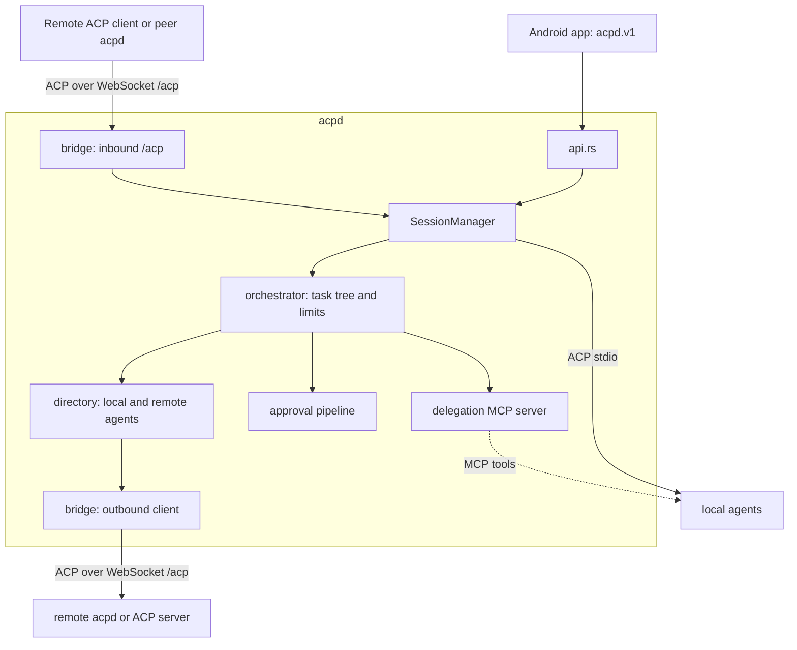

# Agent orchestrator design (acpd module)

Status: design proposal, 13 October 2026. Nothing here is implemented. It does not change the paused acceptance gates in [TODO.md](../TODO.md).

## 1. Goal

Let ACP agents, local or on other hosts, be discovered, launched, supervised and delegated to by one another, without a second remote-shell transport and without changing how the phone works today. Requirements from the user:

1. Remote agents are in scope.
2. A **supervisor agent** may approve a child's permission request when it judges it safe, and may **escalate to the phone** when it is not.
3. The orchestrator is a **module inside `acpd`**, not a separate product.
4. Host-to-host links should use a **bridge built into the server**, so a remote agent looks like any other registry entry.

Non-goals for the first release: A2A interoperability, agent-to-agent traffic that bypasses the host, a hosted relay service, automatic prompt retries.

## 2. What the official specs say (checked 13 October 2026)

The documentation site `agentclientprotocol.com` is blocked by this environment's egress policy. I read the RFD and protocol sources from the `agentclientprotocol/agent-client-protocol` and `a2aproject/A2A` repositories on GitHub (`main`) instead. Statuses below come from each document's revision history, not from a live site, so recheck before building.

| Topic | Source | What it says | Consequence for us |
| --- | --- | --- | --- |
| Remote transport | RFD [Streamable HTTP & WebSocket Transport](https://github.com/agentclientprotocol/agent-client-protocol/blob/main/docs/rfds/streamable-http-websocket-transport.mdx) (moved to Active 2026-07-02; Transports Working Group announced [2026-04-22](https://github.com/agentclientprotocol/agent-client-protocol/blob/main/docs/announcements/transports-working-group.mdx)) | One `/acp` endpoint. Streamable HTTP (POST + SSE GET streams, HTTP/2, `Acp-Connection-Id` / `Acp-Session-Id` headers) or **WebSocket upgrade** on the same endpoint. Clients MUST support both; servers may offer WebSocket only. Cookies required for affinity. Same JSON-RPC and lifecycle as stdio. | The bridge speaks this, WebSocket first. It is not final, so isolate it behind one module. |
| Durability in v1 | same RFD | Sessions survive disconnects and are resumed with `session/load`. **No stream resumption, no replay of messages missed while disconnected**, liveness is the implementer's job. Message IDs and resumption are deferred to v2. | The bridge must keep its own journal cursor and heartbeat. `acpd` already has both (`connection.rs` journal and replay). |
| Auth on remote | same RFD | I did not find an authentication scheme in what I read. | Reuse `acpd` TLS plus device tokens (`security.rs`). Do not invent a new scheme. |
| Subagents | RFD [Subagent Sessions](https://github.com/agentclientprotocol/agent-client-protocol/blob/main/docs/rfds/subagents.mdx) (revised as late as 2026-10-05; status marker not verified) | An agent can expose children as their own session IDs through `subagent_update`, with `session_message` between sessions. Gated by a client `subagents` capability. Child requests are subject to the same client capability and permission checks as the parent, and a child must not be used to get around parent restrictions. Cancellation cascades only along work the cancelled work waits on. | Use as the **outward-facing shape** of the task tree. Our children are created by the host, not by the agent, so we map onto it rather than depend on agents implementing it. |
| Proxy chains / conductor | RFD [Agent Extensions via ACP Proxies](https://github.com/agentclientprotocol/agent-client-protocol/blob/main/docs/rfds/proxy-chains.mdx) | A conductor sits between a client and an agent and forwards or rewrites messages (`proxy/successor`). | Our `acpd` is already a conductor-like broker. Not adopted now; could later let delegation be a proxy rather than an MCP tool. |
| MCP-over-ACP | RFD [MCP-over-ACP](https://github.com/agentclientprotocol/agent-client-protocol/blob/main/docs/rfds/mcp-over-acp.mdx) (draft; targets MCP 2026-07-28 only) | Declare `{"type":"acp"}` MCP servers in `session/new`; tool calls travel over the existing ACP connection. | Cleanest long-term way to hand agents orchestration tools with no extra listener. Needs agent support we cannot assume today. Phase 1 uses ordinary MCP (see 4.2). |
| Trace propagation | RFD [Meta field propagation](https://github.com/agentclientprotocol/agent-client-protocol/blob/main/docs/rfds/meta-propagation.mdx) (Completed 2026-06-03) | `_meta.traceparent`, `tracestate`, `baggage` are reserved for W3C trace context. | Use these to link parent and child spans. |
| Cancellation | RFD [Request cancellation](https://github.com/agentclientprotocol/agent-client-protocol/blob/main/docs/rfds/request-cancellation.mdx) (Completed 2026-06-29) | Stabilized request cancellation. | Cascading cancel can rely on it where an agent advertises it. |
| Agent registry | RFD [ACP Agent Registry](https://github.com/agentclientprotocol/agent-client-protocol/blob/main/docs/rfds/acp-agent-registry.mdx) | Manifest `agent.json` with `id`, `name`, `version`, `description`, `distribution` (`binary`, `npx`, `uvx`). Describes installation, not remote endpoints. | Directory entries should be importable from it. It does not cover remote peers, so peers are our own entries. |
| A2A | [A2A specification](https://github.com/a2aproject/A2A/blob/main/docs/specification.md), latest released **1.0.0** | Separate protocol (Linux Foundation). Agent Card at `/.well-known/agent-card.json`; Task with states `WORKING`, `INPUT_REQUIRED`, `AUTH_REQUIRED`, `COMPLETED`, `FAILED`, `CANCELED`, `REJECTED`; JSON-RPC, gRPC and REST bindings; push notifications. Zed's ACP and A2A are different projects (ACP is editor-to-agent). | Do not build on it first. Borrow its task states for our task model and keep an optional adapter for later. |

Not verified: whether Goose or any other target agent implements the new HTTP/WebSocket transport, `subagents`, or `type: "acp"` MCP servers today. Treat every such use as capability-checked and optional.

## 3. What we reuse

| Need | Existing code |
| --- | --- |
| Directory of agents, executable resolution | `registry.rs`, `discovery.rs` |
| Launch, ACP actor, journal and replay, backpressure | `connection.rs`, `session.rs` |
| Safe process trees and cleanup | `process_tree.rs`, `detached.rs` |
| Host callbacks with consent (`fs/*`, `terminal/*`) | `filesystem.rs`, `terminal.rs` |
| Rules plus model reviewer for shell lines, fail-closed to the phone | `shell_review.rs` |
| Pairing, tokens, TLS, revocation | `security.rs`, `api.rs` |
| MCP server injection into `session/new` (capability checked) | `mcp.rs` |
| Interrupted-session metadata | `session_catalog.rs` |

Hooks that already exist: `AgentDefinition.transport` (today `registry.rs:82` rejects anything except `"stdio"`), and the `_meta.acpdAutoReview` convention for publishing a decision and its layer.

## 4. Architecture



New code lives under `acpd/src/orchestrator/` (a module of the existing crate, no new binary):

| Module | Responsibility |
| --- | --- |
| `directory` | One list of launchable agents: local registry entries plus remote ones. Each entry carries origin (`local`, or a peer name), capabilities from real discovery, and an `own_tools` flag. |
| `tree` | Task nodes with `parent`, `root`, depth, state, budget, owner. Enforces limits. Single owner of lineage. |
| `delegate` | The scoped MCP server given to agents (4.2). |
| `approvals` | The permission pipeline (section 5). |
| `bridge` | Inbound `/acp` endpoint and outbound client (4.3). |
| `supervise` | Timeouts, heartbeats, cascading cancel, restart policy, cleanup. |

### 4.1 Task model

A task is a host-owned record that wraps one child session.

```text
TaskNode { id, parent_task, root_task, depth,
           session (host UUID, as today), agent_ref (local id | peer/agent),
           workspace_scope, state, limits, created_by_session,
           pending_requests[], result }
state: submitted | working | input_required | auth_required
       | completed | failed | canceled | rejected     (names follow A2A 1.0.0)
```

Rules: the host session UUID and the agent's ACP session ID stay separate, as in [AGENTS.md](../AGENTS.md). The tree is in memory; `session_catalog.rs` persists metadata so a restart shows interrupted tasks and never silently restarts them. A task never resends its prompt on reconnect.

### 4.2 Delegation tools (agents reach the orchestrator through MCP)

Most ACP agents are servers and know nothing about each other. The one hook they all honor is `mcpServers` in `session/new`. For each session the host injects a **loopback MCP server scoped by a per-session token**, so the caller identity cannot be spoofed and a child cannot see another tree. It is injected only when the agent advertises the needed MCP capability (same check as `mcp.rs`) and only for agents the operator enabled for orchestration.

| Tool | Behavior |
| --- | --- |
| `agents_list` | Delegable agents visible to the caller, with origin, capabilities, `own_tools`, availability. |
| `task_delegate` | `agent`, `prompt`, `workspace` (name or sub-path within the caller's scope), `isolation` (`shared`, `worktree`), `limits`, `wait` (`true` returns the final result or a `needs_decision` status). |
| `task_status` / `task_result` | State, summary, artifacts, bounded output. |
| `task_send` | Follow-up prompt to an idle child. |
| `task_cancel` | Cancel one task and the work it waits on. |
| `task_decide` | Supervisor's answer to a child's pending permission request (section 5). |

Child output returned to a parent is **untrusted data** and is marked as such in the tool result.

Outward shape: for clients that advertise the ACP `subagents` capability, the host also emits `subagent_update` and routes child traffic as child session IDs. The phone gets the same tree through the `acpd.v1` API. Later, when agents support MCP-over-ACP, the same tools can be declared as `{"type":"acp"}` servers with no listener.

### 4.3 The bridge (built into the server)

The bridge removes the need for a bespoke peer protocol. It is the standard ACP remote transport, implemented once, used in both directions.

**Inbound.** `acpd` serves `/acp` (WebSocket upgrade first, Streamable HTTP later) next to the existing `/v1` API, on the same TLS listener. A remote ACP client, including another `acpd`, connects, runs `initialize`, and then `session/new` with an `agentId`-selection field in `_meta`, because plain ACP has no agent selector (stdio gets its agent from the command line). `acpd` answers with an ordinary session backed by a local registry agent. The ACP wire flow is unchanged; the host callbacks, workspace containment and consent still apply to that agent's callbacks.

**Outbound.** A registry entry may have `transport = "ws"` (later `"http"`) and a URL. Launching it opens an ACP client connection through the bridge instead of spawning a process; the rest of `session.rs` and `connection.rs` see the same actor interface. The `registry.rs:82` check is relaxed only for these types, and the entry cannot carry a command to execute.

Result: a remote agent is just a directory entry. The same bridge also lets a stdio-only agent be exposed remotely with no change to the agent. Peer-to-peer then needs only "pair with that host and add it as a directory source", not a second protocol.

Bridge rules:

- TLS required for any non-loopback listener, exactly as today. Certificate validation is never bypassed.
- Authentication uses existing device tokens in a header, with a `peer` role created by the same one-use 60-second pairing flow. Roles limit what a peer may call (list, create, prompt, cancel) and which agents and workspace aliases it may use.
- Because the v1 transport does not replay missed messages, each bridge session keeps an `acpd` journal cursor (`?after=`-style, as `acpd.v1` already does) and a heartbeat. After a drop the outbound side re-attaches with `session/load` and the cursor and surfaces any gap as a visible history gap.
- Remote workspaces are addressed by **alias**, never by client-supplied paths. The remote host maps aliases to its own allowed roots.
- Code moves between hosts as git branches or patches carried as artifacts, not as shared filesystems.

## 5. Permission pipeline

Today every consent goes to the phone, with an optional rules and model reviewer for shell lines (`shell_review.rs`). Children add many more requests, so requests flow through ordered layers and stop at the first definite answer. Every layer can only narrow what the next layer may allow.

1. **Hard deny (host, deterministic).** The existing hard-deny list plus orchestration limits (outside scope, privileged commands, credential paths). Not overridable by any layer below.
2. **Rules (host, deterministic).** The existing allowlist and classification. Output: `low`, `medium`, `high` risk class plus a host-rendered description.
3. **Supervisor decision.** Only for requests classified `low` or `medium`. The supervisor receives the request as a `needs_decision` result with the host-rendered facts (tool kind, resolved path or command line, cwd relative to the scope, diff size) and answers with `task_decide(allow_once | deny | escalate, rationale)`.
4. **Phone.** Anything `high`, any `escalate`, any timeout, any error, and anything the supervisor did not answer. This is the same consent card users already have.

Safety requirements:

- **Fail closed.** Missing, late or malformed supervisor answers go to the phone. A supervisor is never allowed to approve by silence.
- **Bound to the request.** A decision carries the request id and a digest of the rendered request; it is single-use and cannot be applied to a different request or to the supervisor's own requests.
- **Host-rendered facts only.** The supervisor sees what the host computed, not the child's free-text description, so a child cannot argue its way past review. The supervisor still reads untrusted text elsewhere, so classification caps what it can approve.
- **Ceiling.** The operator config sets the highest risk class a supervisor may approve (default: `medium`, decided by the user on 13 October 2026; `high` always asks the phone). A supervisor cannot widen scope, roots or the ceiling, and cannot approve for tasks outside its subtree.
- **No self-approval.** An agent's decisions never apply to its own requests, and a child never decides for a sibling.
- **Visible and revocable.** Decisions are published as `_meta.acpdAutoReview` with layer `supervisor`, the rationale length-bounded, and the phone shows who approved. The user can pause supervisor approval for a tree at any time; the pending requests then go to the phone.
- **Own-tools caveat.** Agents with `own_tools` edit files and run commands without host callbacks, so no layer can gate them. They are not delegable by default and always show the existing warning.

Child-requested permissions use the same pipeline whether the request comes from the agent's own `session/request_permission` or from a host consent (`host-filesystem`, `host-shell-command`), so the phone sees one consistent card.

## 6. Supervision and limits

Operator config (names indicative), all enforced by the host, none changeable by agents:

```toml
[orchestrator]
enabled = false                 # off by default
max_depth = 2
max_children_per_task = 4
max_tasks_total = 16
task_timeout_secs = 1800
supervisor_max_risk = "medium"  # low | medium; high always asks the phone
[orchestrator.agents.<id>]
delegable = true
peers = ["laptop"]
```

- **Cancel cascade.** Cancelling a task cancels the work it waits on, then ends the process tree on timeout, using existing process cleanup. Background children follow the ACP subagents RFD semantics.
- **Liveness.** Per-task timeout, idle timeout, and bridge heartbeat. Failure marks the task `failed` and notifies its parent; it is never retried automatically.
- **Cycles and fan-out.** Reject delegation back to an ancestor agent in the same workspace, and enforce depth and count limits at admission.
- **Isolation.** A child that writes gets a `git worktree` by default when the workspace is a repository; shared-directory writes are an explicit opt-in.
- **Attenuation.** A child's access is a subset of the parent's: workspace sub-path, file read/write, terminal, MCP servers. The host computes it; a request for more is rejected.
- **Budget.** Turn and wall-clock budgets are always enforced; token budgets only when an agent reports usage.
- **Observability.** `traceparent` is propagated in `_meta`, one span per task. Logging stays metadata-only as today: no prompts, replies, tokens, paths or secrets.

## 7. Security notes

- Prompt injection is the main risk: results flow from one model to another. Mitigations are host-rendered facts, risk ceilings, no self-approval, and untrusted-data marking, but they do not remove the risk. The user judged strong models sufficient for the default (`medium`); the hard-deny list and "high goes to the phone" stay regardless because they are cheap deterministic checks that also catch ordinary model mistakes.
- A paired peer is a credential. Revocation must end its sessions and delegated children immediately (the existing device revocation path, extended to peers).
- Remote execution is a new trust boundary. A remote host enforces its own roots and consent; local policy never grants remote rights.
- The inbound `/acp` surface needs the same rate limits, frame bounds and byte budgets as the WebSocket API.

## 8. Android impact

Not required for the first phases; the existing consent cards already show the layer and reason. Later: a task-tree view and a supervisor-approved badge on cards. Per [AGENTS.md](../AGENTS.md), new screens need Penpot boards in both themes before implementation.

## 9. Phases and acceptance gates

| Phase | Scope | Gate (scope-limited, no production claims) |
| --- | --- | --- |
| 0 | Confirm which specs and agents are real: check Goose support for HTTP/WebSocket, `subagents`, MCP-over-ACP, and re-read the RFD statuses. | Written notes in this document. |
| 1 | `tree`, `directory`, `delegate` for **local** agents with the mock ACP agent. `parent`, limits, cascade cancel, cleanup. | Rust tests: depth/fan-out rejection, cycle rejection, cancel leaves no process, restart shows interrupted tasks. |
| 2 | `approvals`: rules, `task_decide`, fail-closed, single-use digest, escalation to the phone. | Tests: late/malformed/duplicate decisions go to the phone; high risk never supervisor-approved; no self-approval; secrets absent from logs. |
| 3 | Bridge inbound WebSocket `/acp`; outbound `transport = "ws"` directory entries; `peer` role and pairing. | Two `acpd` instances in a test: delegate to a remote mock agent, drop and re-attach with cursor, revoke the peer. TLS required. Actions on Linux and Windows. |
| 4 | Streamable HTTP (once the RFD stabilizes), worktree isolation, `subagent_update` emission. | Compatibility against a second ACP implementation if available. |
| 5 | Real-agent trial (Goose delegating to a second agent), then Android task-tree UI. | Same discipline as `scripts/real-agent-check.py`: record exact cost, scope and limits. |

## 10. Decisions and open questions

Decided by the user on 13 October 2026:

1. Peer links use the new `/acp` endpoint, not `acpd.v1`.
2. `supervisor_max_risk` defaults to `medium`; `high` always goes to the phone.
3. No separate reviewer model. The supervising agent decides, and anything it does not answer goes to the phone.

Still open:

1. How should `session/new` select an agent over `/acp`: a `_meta` field now, or wait for a selector in the spec?
2. Which `own_tools` agents, if any, may ever be delegated to?
3. What happens to a pending approval when the supervisor is busy mid-turn? Current answer: it waits for the timeout, then goes to the phone.
