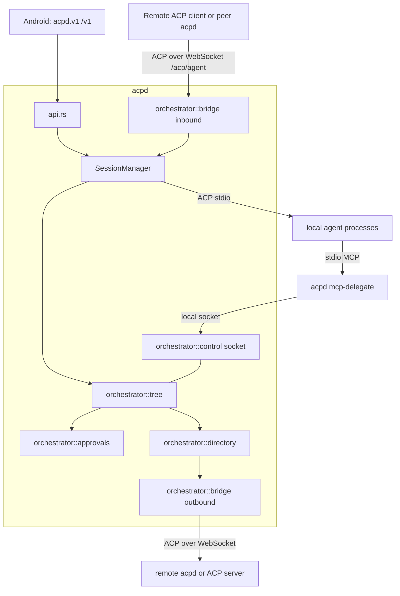

# Agent orchestrator specification (acpd module)

Status: design specification, 13 October 2026. Nothing here is implemented. It does not change the paused acceptance gates in [TODO.md](../TODO.md). "Verified" below means read in a primary source or in this repository on that date; everything else is a proposal.

## 1. Goal and decisions

Let ACP agents, local or on other hosts, be discovered, launched, supervised and delegated to by one another, with no second remote-shell transport and no change to how the phone works today.

Decided by the user:

1. Remote agents are in scope.
2. A **supervisor agent** may approve a child's permission request when it judges it safe, and escalates to the phone when not. Default ceiling `medium`; `high` always goes to the phone.
3. No separate reviewer model. The supervising agent decides; anything unanswered goes to the phone.
4. The orchestrator is a module inside `acpd`.
5. Host-to-host links use the standard ACP **`/acp` endpoint** built into the server (the bridge), not `acpd.v1`.
6. Support nearly all ACP agent CLIs, so the design assumes baseline ACP over stdio only.
7. Prompt injection between strong models is accepted as a residual risk; cheap deterministic checks stay (section 8).

Non-goals for the first release: A2A interoperability, a hosted relay, agent-to-agent traffic that bypasses the host, automatic prompt retries, Android UI.

## 2. Verified findings from official sources

Most facts below were read from the source repositories on GitHub (`main`) while `agentclientprotocol.com` was blocked by this environment's egress policy. The docs site and registry CDN became reachable later (the registry index was read from the CDN); statuses should still be re-checked on the live site before building.

| Topic | Verified fact | Source |
| --- | --- | --- |
| Remote transport | RFD "Streamable HTTP & WebSocket Transport", **Active** on the live RFD index (moved to Active 2026-07-02; a "v2" follow-up is listed separately). One `/acp` endpoint. `POST` for client→server (always `202`, except `initialize` which returns `200` + JSON), long-lived SSE `GET` streams (one per connection plus one per session), HTTP/2 required, `Acp-Connection-Id` / `Acp-Session-Id` headers. A `GET` with `Upgrade: websocket` upgrades; the `101` response carries `Acp-Connection-Id`; messages are JSON-RPC **text frames** (binary ignored); the client must still send `initialize` first. Clients MUST support both; servers MAY offer WebSocket only. Cookies required for affinity. Batches return `501`. `DELETE` ends a connection. | [RFD](https://github.com/agentclientprotocol/agent-client-protocol/blob/main/docs/rfds/streamable-http-websocket-transport.mdx) |
| v1 durability | Sessions survive disconnects and resume via `session/load`. **No sequencing, no replay of messages missed while disconnected, liveness is the implementer's job.** Message IDs and `Last-Event-ID` resumption are deferred to v2. Phase 4 (origin validation, protocol-version header, security audit) is still future work. | same RFD |
| Authentication on remote | Not defined in the RFD as read. | same RFD |
| Reference implementation | Goose (`block/goose`) is the reference implementation in progress; Rust SDK (`sacp`) next. | same RFD |
| MCP servers | **All agents MUST support MCP servers over stdio.** HTTP and SSE are optional and advertised as `mcpCapabilities.http` / `.sse`. `session/new` takes `cwd` and `mcpServers: [{name, command, args, env}]`. | [session-setup](https://github.com/agentclientprotocol/agent-client-protocol/blob/main/docs/protocol/v1/session-setup.mdx) |
| Permission | `session/request_permission` carries `sessionId`, `toolCall`, `options[{optionId,name,kind}]` with kinds including `allow_once` and `reject_once`; answers are `{"outcome":{"outcome":"selected","optionId":…}}` or `{"outcome":{"outcome":"cancelled"}}` (matches `connection.rs`). Tool kinds: `read`, `edit`, `delete`, `move`, `search`, `execute`, `think`, `fetch`, `switch_mode`, `other`. | [tool-calls](https://github.com/agentclientprotocol/agent-client-protocol/blob/main/docs/protocol/v1/tool-calls.mdx) |
| Cancellation | `session/cancel` ends a prompt turn with stop reason `cancelled`; the client must answer pending permission requests with `cancelled`. `$/cancel_request` is a stabilized, optional request cancel (error `-32800`). | [prompt-turn](https://github.com/agentclientprotocol/agent-client-protocol/blob/main/docs/protocol/v1/prompt-turn.mdx), [RFD](https://github.com/agentclientprotocol/agent-client-protocol/blob/main/docs/rfds/request-cancellation.mdx) |
| Initialization and capabilities | `initialize` carries one integer protocol version (agent answers the same version or its latest; the client should close on a mismatch), `clientCapabilities` (`fs.readTextFile`, `fs.writeTextFile`, `terminal`, `elicitation`, `auth.terminal`, …) and `clientInfo`. Omitted capabilities mean unsupported. Agents answer `agentCapabilities` (`loadSession`, `promptCapabilities`, `mcpCapabilities`, `auth.logout`, `sessionCapabilities`) and `authMethods`. | [initialization](https://github.com/agentclientprotocol/agent-client-protocol/blob/main/docs/protocol/v1/initialization.mdx) |
| Baseline vs optional methods | Every agent MUST support `session/new`, `session/prompt`, `session/cancel`, `session/update`. Optional, each advertised: `session/load` (`loadSession`, replays history), `session/resume` (`sessionCapabilities.resume`, **no replay**), `session/close` (`.close`), `session/list`, `session/delete`, `additionalDirectories`. A client MUST NOT call an unadvertised method. | [initialization](https://github.com/agentclientprotocol/agent-client-protocol/blob/main/docs/protocol/v1/initialization.mdx), [session-setup](https://github.com/agentclientprotocol/agent-client-protocol/blob/main/docs/protocol/v1/session-setup.mdx) |
| Working directory | `cwd` MUST be an absolute path, is used regardless of where the agent was spawned, and is part of the effective root set (`[cwd, …additionalDirectories]`) that SHOULD bound tool file operations. | session-setup |
| Stop reasons | `end_turn`, `max_tokens`, `max_turn_requests`, `refusal`, `cancelled`. | [prompt-turn](https://github.com/agentclientprotocol/agent-client-protocol/blob/main/docs/protocol/v1/prompt-turn.mdx) |
| Usage and cost | Agents MAY send `usage_update` with required `used` and `size` token counts and an optional `cost {amount, currency}` (ISO 4217). | prompt-turn |
| Authentication | `authMethods` with types `agent` (client calls `authenticate`) and `terminal` (client re-runs the agent interactively, only if the client advertised `auth.terminal`); optional `logout`. New sessions require authentication again after logout. | [authentication](https://github.com/agentclientprotocol/agent-client-protocol/blob/main/docs/protocol/v1/authentication.mdx) |
| Extensibility | Custom data goes in `_meta` (`{[key: string]: unknown}`); implementations MUST NOT add custom fields at the root of a spec type; custom methods MUST start with `_`; W3C trace keys are reserved at the root of `_meta`. | [extensibility](https://github.com/agentclientprotocol/agent-client-protocol/blob/main/docs/protocol/v1/extensibility.mdx) |
| Subagents | RFD adds `subagent_update` and `session_message` with a client `subagents` capability. Child requests are subject to the same client checks as the parent. Cancellation cascades only along work the cancelled work waits on. **Draft** on the live RFD index (checked 13 October 2026), revised as late as 2026-10-05. | [RFD](https://github.com/agentclientprotocol/agent-client-protocol/blob/main/docs/rfds/subagents.mdx) |
| MCP-over-ACP | **Draft** (live RFD index); declares `{"type":"acp"}` MCP servers; targets MCP 2026-07-28 only. | [RFD](https://github.com/agentclientprotocol/agent-client-protocol/blob/main/docs/rfds/mcp-over-acp.mdx) |
| Trace context | `_meta.traceparent`, `tracestate`, `baggage` reserved for W3C trace context. **Completed** (live index). | [RFD](https://github.com/agentclientprotocol/agent-client-protocol/blob/main/docs/rfds/meta-propagation.mdx) |
| Registry | **Completed** RFD. Manifest `<id>/agent.json` with `distribution` of `binary`, `npx` or `uvx`; the registry only lists agents that return valid `authMethods` in the ACP handshake. Index at `cdn.agentclientprotocol.com/registry/v1/latest/registry.json` (unreachable here). | [registry](https://github.com/agentclientprotocol/registry) |
| MCP tools | Tools have `inputSchema`, optional `outputSchema`; results may carry `structuredContent`; tool failures use `isError: true`. | [MCP tools](https://github.com/modelcontextprotocol/modelcontextprotocol/blob/main/docs/specification/2025-06-18/server/tools.mdx) |
| A2A | Latest release 1.0.0; Agent Card at `/.well-known/agent-card.json`; task states `WORKING`, `INPUT_REQUIRED`, `AUTH_REQUIRED`, `COMPLETED`, `FAILED`, `CANCELED`, `REJECTED`. Separate project from Zed's ACP. | [A2A spec](https://github.com/a2aproject/A2A/blob/main/docs/specification.md) |

### 2.1 Registry agents (read from the official index, 13 October 2026)

Source: `https://cdn.agentclientprotocol.com/registry/v1/latest/registry.json` (index version 1.0.0, `extensions` empty), fetched after the network policy was opened. The [registry page](https://agentclientprotocol.com/get-started/registry) lists the same 41 agents, all curated to support authentication. None has been run by us; versions change hourly.

| id | version | launch (distribution) |
| --- | --- | --- |
| agoragentic-acp | 1.3.0 | npx `agoragentic-mcp@1.3.0 --acp` |
| amp-acp | 0.10.0 | binary `./amp-acp` |
| antigravity-acp | 1.3.0 | binary `./agy_acp_server.par` |
| auggie | 0.36.0 | npx `@augmentcode/auggie@0.36.0 --acp` |
| autohand | 0.2.1 | npx `@autohandai/autohand-acp@0.2.1` |
| claude-acp | 0.89.1 | npx `@agentclientprotocol/claude-agent-acp@0.89.1` |
| cline | 3.0.70 | npx `cline@3.0.70 --acp` |
| codebuddy-code | 2.164.0 | npx `@tencent-ai/codebuddy-code@2.164.0 --acp` |
| codex-acp | 2.2.2 | npx `@agentclientprotocol/codex-acp@2.2.2` |
| cortex-code | 1.0.73 | binary `./coco-1.0.73+180523.e6179a031de9-darwin-arm64/cortex acp serve` |
| corust-agent | 0.6.0 | binary `./corust-agent-acp` |
| crow-cli | 0.1.24 | binary `./crow-cli acp` |
| cursor | 2026.10.01 | binary `./dist-package/cursor-agent acp` |
| deepagents | 0.1.7 | npx `deepagents-acp@0.1.7` |
| devin | 3000.11.3 | binary `./bin/devin acp` |
| dimcode | 0.5.17 | npx `dimcode@0.5.17 acp` |
| dirac | 0.5.20 | npx `dirac-cli@0.5.20 --acp` |
| factory-droid | 0.240.0 | npx `droid@0.240.0 exec --output-format acp-daemon` |
| fast-agent | 0.10.1 | uvx `fast-agent-acp==0.10.1 -x` |
| gemini | 0.63.0 | npx `@google/gemini-cli@0.63.0 --acp` |
| github-copilot-cli | 1.0.96 | npx `@github/copilot@1.0.96 --acp` |
| glm-acp-agent | 1.14.0 | npx `glm-acp-agent@1.14.0` |
| goose | 1.54.0 | binary `./goose acp` |
| grok-build | 1.0.54 | npx `@xai-official/grok@1.0.54 agent stdio` |
| harn | 0.10.165 | binary `./harn serve acp` |
| junie | 3579.7.0 | binary `./Applications/junie.app/Contents/MacOS/junie --acp=true` |
| kilo | 7.8.8 | npx `@kilocode/cli@7.8.8 acp`; binary `./kilo acp` |
| kimchi | 1.9.2 | binary `./bin/kimchi --mode acp` |
| kimi | 1.52.0 | binary `./kimi acp` |
| minimax-code | 0.2.7 | npx `@minimax-ai/code@0.2.7 acp` |
| minion-code | 0.1.44 | uvx `minion-code@0.1.44 acp` |
| mistral-vibe | 2.26.1 | binary `./vibe-acp` |
| nova | 1.1.52 | npx `@compass-ai/nova@1.1.52 acp` |
| opencode | 1.19.0 | binary `./opencode acp` |
| pi-acp | 0.0.34 | npx `pi-acp@0.0.34` |
| poolside | 1.0.16 | binary `./pool-darwin-arm64 acp` |
| qoder | 0.2.14 | npx `@qoder-ai/qodercli@0.2.14 --acp` |
| qwen-code | 0.25.1 | npx `@qwen-code/qwen-code@0.25.1 --acp --experimental-skills` |
| sigit | 1.6.8 | npx `@smbcloud/sigit@1.6.8`; binary `./sigit` |
| stakpak | 0.3.88 | binary `./stakpak acp` |
| vtcode | 0.96.14 | binary `./vtcode acp` |

Index facts that shape the design:

- **Distributions:** 22 agents use `npx`, 19 `binary`, 2 `uvx` (Kilo and siGit offer both `npx` and `binary`). Binary entries are per-platform archives with a `sha256`. Coverage differs: for example `kimi` has no `darwin-x86_64`, and `corust-agent` and `vtcode` have no `linux-aarch64`, so availability must be checked per platform before launch.
- **Manifest env:** an entry may carry launch `env` (for example Factory Droid disables auto-update). Import must copy it into the registry entry as plain environment values, never as secrets.
- **Same-name manifests:** the earlier GitHub probe found a `github-copilot` manifest (1.553.0, language server) that is **not** in the index. The index's Copilot is `github-copilot-cli` 1.0.96 (`@github/copilot --acp`). The index wins; the probe was a stale or unlisted manifest.
- **Auth:** every listed agent returns valid `authMethods` at handshake, so the host should expect sign-in to be required before first use (`auth_required` is surfaced, never auto-handled).

Consequence: most agents launch through `npx` (a literal executable plus an argument array, which the existing registry already supports). Registry import (read from the index, with archive `sha256` checked for binaries) must resolve the `npx`/`uvx` executable like any other, never through a shell, and keep the existing rule that discovery resolves configured executables only.

## 3. What is reused (verified in this repository)

| Need | Code |
| --- | --- |
| Agent directory, executable resolution | `registry.rs` (`AgentDefinition`, `transport` field currently rejected unless `"stdio"` at `registry.rs:82`), `discovery.rs` |
| One agent process per host session, initialize, `session/new`, load | `SessionManager::open` in `session.rs` (spawns one `AcpConnection` per session) |
| ACP actor, journal with sequence and replay, byte budgets, pending-permission tracking | `connection.rs` |
| Host consent for `fs/*` and `terminal/*`, `_meta.acpdSource` | `connection.rs`, `filesystem.rs`, `terminal.rs` |
| Rules and model reviewer returning `Decision::{Allow,Ask,Deny}`, `_meta.acpdAutoReview` | `shell_review.rs` |
| Bearer-token authentication on all `/v1` routes, 60-second one-use pairing | `api.rs::authenticate`, `security.rs` |
| `acpd.v1` WebSocket with `?after=` cursor and single-controller lease | `api.rs::connect`, `socket_session` |
| MCP server validation against advertised capabilities | `mcp.rs` |
| Process-tree cleanup | `process_tree.rs` |
| Interrupted-session metadata | `session_catalog.rs` |
| Strict config parsing (`deny_unknown_fields`), soft reload of future launches | `config.rs`, `session.rs::reload`, [daemon-and-reload](daemon-and-reload.md) |

## 4. Architecture



New code, `acpd/src/orchestrator/`, in the existing crate (no new binary, one new subcommand `acpd mcp-delegate`):

| File | Responsibility |
| --- | --- |
| `mod.rs` | `Orchestrator` handle owned by `SessionManager`; config snapshot per launch |
| `tree.rs` | `TaskNode` store, lineage, limits, state machine |
| `directory.rs` | Merges local registry agents and peer agents into `DirectoryEntry` |
| `control.rs` | Local-socket server used by `mcp-delegate`; token binding |
| `delegate.rs` | MCP tool definitions and handlers (also the `mcp-delegate` subcommand) |
| `approvals.rs` | Risk classification, pending requests, supervisor decision, escalation |
| `bridge/inbound.rs` | `/acp` WebSocket endpoint |
| `bridge/outbound.rs` | WebSocket ACP client used for `transport = "ws"` agents |
| `peers.rs` | Peer records, credentials, `peer` role |
| `supervise.rs` | Timeouts, heartbeat, cascading cancel, cleanup |

## 5. Task model

```rust
struct TaskNode {
    id: Uuid,
    parent: Option<Uuid>,        // None = a root task started by phone or API
    root: Uuid,
    depth: u8,
    session: Uuid,               // host session id (distinct from the ACP session id)
    agent: AgentRef,             // Local(id) | Peer { peer, id }
    scope: WorkspaceScope,       // sub-path of the caller's scope, plus rights
    isolation: Isolation,        // Shared | Worktree(path)
    limits: TaskLimits,          // deadline, idle timeout, max_children
    state: TaskState,
    pending: Vec<PendingRequest>,
    result: Option<TaskResult>,  // bounded summary + artifact refs
    created_by: Principal,       // Phone(device) | Task(Uuid)
}
enum TaskState { Submitted, Working, InputRequired, AuthRequired,
                 Completed, Failed, Canceled, Rejected }   // A2A 1.0.0 names
```

State transitions (anything else is a bug):

| From | To | Trigger |
| --- | --- | --- |
| Submitted | Working | child `session/prompt` sent |
| Submitted | Rejected | admission failed (limits, cycle, scope, agent not delegable) |
| Working | InputRequired | a pending `session/request_permission` or elicitation needs an answer |
| InputRequired | Working | request answered |
| Working / InputRequired | AuthRequired | `session/new` or the prompt fails with `auth_required` (`-32000`), or the agent advertised `authMethods` and rejected the session until authenticated. Never handled automatically: the host does not call `authenticate`, does not run terminal login for a child, and reports which `authMethods` ids the agent offered so the phone or operator can sign in |
| Working | Completed | prompt stop reason `end_turn`, or `max_tokens` / `max_turn_requests` (recorded as `stop_reason` and `truncated: true`, not as failure) |
| Working | Rejected | prompt stop reason `refusal` |
| Working | Failed | process exit, protocol error, deadline, bridge loss not recovered |
| Working / InputRequired | Canceled | cancel requested and prompt ends `cancelled` |
| Completed | Working | `task_send` follow-up on the same child |

Rules: host session UUID and ACP session ID stay separate. A task's `rights` decide the `clientCapabilities` the host sends in `initialize` for the child: no write right means `fs.writeTextFile` is omitted, no terminal right means `terminal` is omitted. Omitted capabilities are unsupported by the spec, so the attenuation is enforced by negotiation as well as by the host callbacks. The host never advertises `auth.terminal` to a child. A task's workspace scope is the child's `cwd` (an absolute path, spec-required); `additionalDirectories` is not used in v1, so a sub-path scope is simply a deeper `cwd`. The tree is in memory; `session_catalog.rs` persists metadata so a restart shows interrupted tasks as `Failed (interrupted)` and **never restarts them or resends prompts**. Terminal states are final except `Completed → Working`.

### 5.1 Admission checks (reject with a specific code before any process starts)

| Check | Code |
| --- | --- |
| `orchestrator.enabled` false | `orchestrator_disabled` |
| depth would exceed `max_depth` | `depth_limit` |
| parent already has `max_children_per_task` open children, or total open tasks ≥ `max_tasks_total` | `fan_out_limit` |
| target agent not `delegable`, not enabled, or not visible to the caller | `agent_not_delegable` |
| same agent id in the same workspace already an ancestor | `cycle` |
| requested scope not inside the caller's scope | `scope_not_allowed` |
| requested rights exceed the caller's rights | `rights_not_allowed` |
| `max_sessions` reached | `session_limit` |

## 6. Delegation interface (agents reach the orchestrator through MCP)

### 6.1 Wiring

On `session/new` for an agent that has `orchestrate = true` in config, `acpd` appends one MCP server to the request:

```json
{ "name": "acpd-orchestrator",
  "command": "<absolute path of the running acpd>",
  "args": ["mcp-delegate"],
  "env": [{"name":"ACPD_CONTROL","value":"<socket or pipe path>"},
          {"name":"ACPD_TASK_TOKEN","value":"<random 256-bit token>"}] }
```

This is the stdio form that every ACP agent must support (verified), so no agent capability check is needed beyond the agent accepting the `session/new`. The token is generated per session, bound to that session's task and subtree, held only in memory, and invalid after the session ends. `mcp-delegate` is a plain MCP stdio server (JSON-RPC over stdio, `initialize`, `tools/list`, `tools/call`) that forwards each call to the control socket and returns the answer. It reads nothing else and logs nothing to stdout except MCP messages.

The control socket is a Unix domain socket in the state directory (mode `0600`) or a Windows named pipe with an owner-only ACL. The token is checked on every call; an unknown or expired token returns `isError: true` with code `invalid_task_token`. The token reaches the agent process environment, so it is scoped to exactly what that session could already do through the tools; it grants nothing to anyone without the socket.

An HTTP MCP server is used only if an agent advertises `mcpCapabilities.http` **and** stdio proved unusable (phase 0 decides per CLI).

### 6.2 Tools

All tools return both a human `text` content block and `structuredContent` with an `outputSchema`. Errors use `isError: true` with a stable code from 5.1 or the table in 6.3.

| Tool | Input (JSON Schema summary) | Output |
| --- | --- | --- |
| `agents_list` | `{}` | `{agents:[{ref, name, origin:"local"\|peer, available, tier, own_tools, delegable}]}` |
| `task_delegate` | `{agent: ref, prompt: string(≤64 KiB), workspace?: string (relative sub-path or alias), isolation?: "shared"\|"worktree", rights?: {read?,write?,terminal?}, deadline_seconds?: int, wait_seconds?: int(0..120, default 0)}` | `{task_id, state, summary?, result?}` |
| `task_status` | `{task_id?}` (omit = all my children) | `{tasks:[{task_id, state, agent, updated_at, summary?, needs_decision:[{request_id, digest, kind, risk, facts}]}]}` |
| `task_result` | `{task_id, max_bytes?}` | `{state, result, truncated, untrusted: true}` |
| `task_send` | `{task_id, prompt}` | `{state}` (only from `Completed`; otherwise `invalid_state`) |
| `task_cancel` | `{task_id}` | `{state}` |
| `task_decide` | `{task_id, request_id, digest, decision:"allow_once"\|"deny"\|"escalate", rationale: string(≤500)}` | `{applied: bool, outcome}` |

`wait_seconds = 0` returns immediately (default). A positive value holds the call up to that many seconds and then returns the current state, so a long task never needs a tool call that outlives an agent's tool timeout.

`result` is always bounded (`task_result` default 32 KiB) and carries `untrusted: true`; the delegating agent's instructions should tell it to treat that content as data. `facts` in `needs_decision` come only from host-computed values (6.4), never the child's description.

### 6.3 Error codes

`invalid_task_token`, `invalid_state`, `unknown_task`, `unknown_request`, `digest_mismatch`, `already_answered`, `risk_too_high`, `not_authorized_for_task` (not in the caller's subtree), plus the admission codes in 5.1.

### 6.4 Outward shape

For clients that advertise the ACP `subagents` capability, the host also emits `subagent_update` for each child. The phone sees the same tree through new REST routes (section 9.3).

## 7. The bridge (`/acp`)

### 7.1 Inbound endpoint

Served on the existing listener (same TLS rules: remote listeners require TLS; Android and peers validate certificates).

| Route | Behavior |
| --- | --- |
| `GET /acp/{agent_id}` with `Upgrade: websocket` | Authenticate (7.3), look up the agent (`agent_not_found` 404), upgrade. The `101` includes `Acp-Connection-Id: <uuid>`. Text frames only; binary frames ignored; max message size = `runtime.max_frame_bytes`. |
| `GET /acp` without an agent | `400 agent_required`. Standard ACP has no way to name an agent, so the agent is part of the path. |
| `POST`, `GET` (SSE), `DELETE` on `/acp/...` | Not implemented in phase 3. Return `501 transport_not_supported`. Streamable HTTP waits for the RFD to stabilize (phase 4). |

Behavior on the socket, using the existing one-process-per-session model (`SessionManager::open`):

1. `initialize`: answered by the host. It must negotiate the protocol version as the spec requires (reply the same version if supported, else the latest the host supports, which today is 1) and return that agent's cached `agentCapabilities` and `authMethods`; the host advertises only the `sessionCapabilities` it can actually honor through the bridge. No process is spawned yet. If no cached initialization exists, the host spawns the agent once, initializes, caches the result and stops the probe process.
2. `session/new`: runs `SessionManager::open_configured` (workspace validation, spawn, real `initialize`, `session/new`) and returns the agent's ACP `sessionId`. The host keeps the map `ACP sessionId ↔ host session UUID`.
3. All later traffic for that `sessionId` is forwarded to that session's `AcpConnection` actor, so callbacks, consent, byte budgets and journal apply exactly as for the phone. Requests for an unknown `sessionId` return JSON-RPC error `-32602`.
4. `session/resume` (no replay) when the agent advertised `sessionCapabilities.resume`, `session/load` (history replay) when it advertised `loadSession`; each only if advertised, otherwise `-32601`. `session/close` is forwarded when advertised, and the host also ends the process.
5. Socket close or `DELETE`: sessions created on this connection are **kept for `bridge_resume_seconds` (default 120)** so the remote side can reattach with `session/load`; after that they are removed. The host never replays prompts.

Because ACP v1 over HTTP/WebSocket does not replay missed messages, the host keeps the journal and the bridge adds one extension that is ignored by other implementations: after `session/load`, the host sends a `session/update` with `_meta.acpdGap = {missed: n}` (inside `_meta`, as the extensibility rules require; never a custom root field) when events were lost. Non-acpd clients simply do not see the extra field.

Frame limits, rate limits, ping interval (default 20 s, close after 3 missed pongs) and the byte budgets in `connection.rs` apply per bridge connection.

### 7.2 Outbound client

Registry entry for a remote agent:

```json
{ "id": "laptop-goose", "name": "Goose on laptop",
  "transport": "ws", "url": "wss://laptop.example:8765/acp/goose",
  "peer": "laptop", "delegable": true }
```

Rules: `transport = "ws"` entries must have `url` with scheme `wss` (or `ws` only to loopback for tests), must not have `command`/`args`/`env`, and take credentials only from the named `peer` record (never from the registry file). Launch: open WebSocket, send `initialize`, `session/new` with `cwd` = the remote path from the peer's alias table (7.4), then hand the connection to the same `AcpConnection` interface that stdio uses (a transport trait with `send(frame)` / `recv() -> frame` / `close()`), so `session.rs` is unchanged apart from choosing the transport. `registry.rs:82` is relaxed only for `transport = "ws"`.

Reconnect: after a drop the client reconnects with exponential backoff (1 s … 30 s, max 6 tries), sends `initialize`, then `session/resume` if advertised (preferred: no history replay) or `session/load` with the remembered ACP session ID. It never resends an in-flight `session/prompt` or a permission answer. A prompt in flight when the link dropped is reported to the parent as `Failed (link lost)` unless the reload proves it finished.

### 7.3 Authentication and roles

Existing bearer device tokens, unchanged format, sent in the `Authorization: Bearer` header on the WebSocket upgrade over TLS. A new device **role** is added to the paired-device record:

| Role | May call |
| --- | --- |
| `phone` (existing default) | everything it can today |
| `peer` | `/acp/{agent_id}` for agents in its allow list; `GET /v1/peer/info`; nothing else |

Peer pairing uses the same one-use 60-second code flow: `acpd peer pair --name laptop --address https://…` on the initiating host prints a code request to the other host's operator; the resulting token is stored in a `0600` peer file in the state directory (`peers.json`, same protections as device tokens), never in `config.toml`, the registry, logs or reports. Revoking a peer ends all its sessions and delegated subtree immediately.

### 7.4 Workspaces on remote hosts

Remote paths are never accepted from the caller. `GET /v1/peer/info` (peer role) returns the peer's `agents` (with `own_tools`, `delegable`) and `workspaceAliases` (`name`, no absolute path exposed beyond what the operator marks as shareable). The delegating host resolves an alias to a path internally and the remote `config.workspace()` check still applies. Code moves between hosts as git branches or patches carried in `task_result` artifacts, never as a shared filesystem.

### 7.5 Protocol conformance rules for the host

1. **Capability gating.** The host calls only methods the agent advertised and never assumes optional ones (`session/load`, `resume`, `close`, `list`, `delete`).
2. **Extensions.** Host data lives only in `_meta` (`acpdAutoReview`, `acpdSource`, `acpdGap`, `traceparent`). If a custom method is ever needed it must start with `_` (for example `_acpd/…`); none is required by this design.
3. **Cancellation.** On `session/cancel` the host answers every pending permission request for that turn with `{"outcome":{"outcome":"cancelled"}}` and expects the prompt to end with stop reason `cancelled`. `$/cancel_request` is used only if the agent advertises support.
4. **Version.** Only protocol version 1 is spoken (the current stable version; see section 15). A different version in the peer's reply closes the connection with a visible error.
5. **Unknown payloads.** Unknown fields and updates are preserved and forwarded (as in `AGENTS.md`).

## 8. Permission pipeline

Every pending permission in a task tree is a `PendingRequest`:

```rust
struct PendingRequest {
    request_id: String,       // JSON-RPC id of session/request_permission
    task: Uuid,
    source: Source,           // AgentOwn | HostFilesystem | HostShell | HostTerminal
    kind: ToolKind,           // ACP tool kind, or Execute for host shell
    facts: Facts,             // host-rendered, see below
    risk: Risk,               // Low | Medium | High (computed by the host)
    digest: [u8; 32],         // SHA-256 of canonical JSON of (task, request_id, source, kind, facts, option ids)
    answered: AtomicBool,
}
```

`Facts` are values the host computes, never the child's free text: resolved path relative to the task scope (or `outside`), command line and cwd (host shell), diff size in bytes for edits, option ids and kinds, and the agent's `own_tools` flag.

### 8.1 Risk classification (deterministic)

| Situation | Risk |
| --- | --- |
| `Decision::Deny` from `shell_review` hard-deny, or outside scope, credential/dot-config paths, privileged commands | **Denied** (not decidable by anyone) |
| `read`, `search`, `think`, `switch_mode` inside scope | Low |
| `shell_review` rules `Allow` (read-only/test commands inside scope) | Low |
| `edit`, `move` inside scope and within `max_edit_bytes` | Medium |
| `execute` through shell review `Ask` for non-sensitive lines | Medium |
| `delete`, `fetch`/network, writes outside scope, large edits, anything marked sensitive by `shell_review`, `own_tools` agents, `other` | High |

`switch_mode` and `other` kinds are treated by the strictest applicable row; unknown kinds are High.

### 8.2 Flow

1. A request arrives (agent's own `session/request_permission`, or a host consent such as `host-filesystem` / `host-shell-command`). The host classifies it.
2. **Denied** → the agent gets a refusal using the existing callback-denied code.
3. **High** → published to the phone immediately; the supervisor can still see it in `task_status` (read-only, `risk_too_high` on `task_decide`).
4. **Low/Medium and risk ≤ `supervisor_max_risk`** → recorded as `needs_decision` in the parent's `task_status`. The phone also sees it, so a human can answer first; the first valid answer wins (atomic compare-and-set on `answered`).
5. The supervisor calls `task_decide` with the `digest`. The host recomputes the digest; a mismatch returns `digest_mismatch` and applies nothing. `allow_once` selects the option of kind `allow_once`; `deny` selects `reject_once`; `escalate` sends the card to the phone with the rationale attached.
6. **No answer within `supervisor_timeout_seconds`** (default 60), supervisor session gone, error, malformed call or any failure → the request goes to the phone. It never auto-allows.
7. Every supervisor outcome is published as `_meta.acpdAutoReview = {"decision","layer":"supervisor","rationale"}` (rationale length-bounded, content never logged), so the phone shows who approved.

Elicitation requests (`elicitation/create`, form or URL) from a child are **never decidable by the supervisor**: they need a human's input, so the task becomes `InputRequired` and the card goes to the phone. The host advertises `elicitation` to a child only when a phone is attached to the root task, otherwise the capability is omitted so the agent does not ask.

Additional rules: a decision is single-use; an agent cannot decide on its own requests or those of tasks outside its subtree; `supervisor_max_risk` cannot be raised by an agent; the user can pause supervisor approval for a root task, after which all pending requests go to the phone. Agents with `own_tools` never get supervisor approval (the host cannot see their edits).

## 9. Configuration, API and CLI

### 9.1 Config (`config.toml`, strict parsing)

```toml
[orchestrator]
enabled = false                      # off by default; restart or soft reload for future launches
max_depth = 2                        # 1..8
max_children_per_task = 4            # 1..16
max_tasks_total = 16                 # 1..64, counted with [runtime].max_sessions
task_timeout_seconds = 1800          # 30..86400
idle_timeout_seconds = 300           # 30..3600
supervisor_max_risk = "medium"       # "low" | "medium"; "high" is not allowed
supervisor_timeout_seconds = 60      # 5..600
task_max_cost_usd = 0                # 0 = off; enforced only when the agent reports cost in USD
max_edit_bytes = 262144              # medium ceiling for edits
bridge_resume_seconds = 120          # 0..3600
bridge_ping_seconds = 20             # 5..120

[orchestrator.agents.goose]          # keyed by agent id
orchestrate = true                   # agent receives the delegation tools
delegable = true                     # may be a child
```

Validation follows `config.rs`: unknown keys rejected; values outside ranges fail startup/reload; `enabled = true` requires non-empty `workspace_roots`. Reload rules follow [daemon-and-reload](daemon-and-reload.md): existing sessions keep their snapshot; the listener, TLS and peer-role changes need a restart.

### 9.2 CLI

`acpd mcp-delegate` (internal; used only as an MCP stdio server), `acpd peer pair|list|revoke`, `acpd tasks` (operator view of the tree).

### 9.3 REST additions (phone and operator, `phone` role)

| Route | Purpose |
| --- | --- |
| `GET /v1/tasks`, `GET /v1/tasks/{id}` | Tree and task detail with `needs_decision` (phone may also answer) |
| `POST /v1/tasks/{id}/cancel` | Cancel a task and what it waits on |
| `POST /v1/tasks/{id}/supervisor/pause` / `resume` | Stop/restore supervisor approvals for a root |
| `GET /v1/peers`, `DELETE /v1/peers/{name}` | List and revoke peers |
| `GET /v1/peer/info` | (peer role) agents and workspace aliases |

The existing consent answering path is unchanged; `acpd.v1` frames gain an optional `taskId` for child sessions.

## 10. Supervision, limits and cleanup

- **Cancel cascade.** `task_cancel` or phone cancel: send `session/cancel` to the child, answer its pending permissions `cancelled`, wait up to 5 s for the turn to end `cancelled`, then cancel the child's own children, then terminate the process tree through `process_tree.rs` if still alive. Closing a parent ends all descendants.
- **Liveness.** Per-task deadline, idle timeout (no events), WebSocket ping for remote links. Failure marks `Failed` and notifies the parent through `task_status`; no automatic retry.
- **Isolation.** A writing child gets a `git worktree` under the state directory when the workspace is a git repository and `isolation` is not `shared`; the worktree is removed with the task unless it holds uncommitted changes, in which case it is kept and reported. Non-git workspaces use `shared` only after an explicit phone consent.
- **Attenuation.** A child's scope and rights (read, write, terminal, MCP servers) are always a subset of its parent's, computed by the host. A request for more is `rights_not_allowed`.
- **Budgets.** Wall-clock and turn budgets always. Token and cost budgets are enforced only from `usage_update` (`used`/`size`, optional `cost`), so an agent that never sends it is unmetered; a cost budget applies only to `USD` amounts and is reported as "unmetered" otherwise. When a budget is exceeded the host cancels the child, and the task ends `Failed (budget)`.
- **Tracing.** `_meta.traceparent` is propagated from root task to children, one span per task. Logs stay metadata-only as today: no prompts, replies, tokens, paths or secrets.
- **Byte bounds.** Task results, `needs_decision` lists and bridge frames reuse the existing byte budgets; nothing new is unbounded.

## 11. Security

- **Prompt injection** is accepted as residual by the user; results are marked `untrusted`, facts are host-rendered, and the hard-deny list plus "High goes to the phone" stay because they are cheap deterministic checks that also catch ordinary model mistakes.
- **A paired peer is a credential.** Revocation ends its sessions and delegated subtree. Peer tokens are never logged or reported.
- **Remote is a trust boundary.** A remote host enforces its own roots and consent; local policy never grants remote rights.
- **`ACPD_TASK_TOKEN`** is visible to the agent process by design; it is session-scoped, socket-bound, memory-only and not logged.
- **`/acp`** has the same TLS requirement, frame bound, rate limit and byte budgets as the existing WebSocket API. Origin validation follows the RFD's phase 4 once defined.

## 12. Compatibility with ACP agent CLIs

| Tier | Agent supports | Works |
| --- | --- | --- |
| A | Baseline ACP over stdio | Can be a child; supervised, cancelled, shown in the tree |
| B | Accepts stdio MCP servers in `session/new` (mandatory in the spec) | Can also delegate (be a supervisor) |
| C | HTTP/WebSocket transport, `subagents`, MCP-over-ACP, `session/load` | Optional improvements |

Fallbacks: an agent that ignores or fails MCP setup is child-only. A stdio-only agent is made remote by the bridge. No `session/load` means a task is not resumable after a restart. `own_tools` agents run but are never auto-approved. Tier is stored per directory entry from real discovery, never from the agent name.

Phase 0 builds a compatibility table from the registry index (section 2.1: all 41 listed agents) plus any others the operator adds, with these checks per CLI: launches by the registry command; `initialize` and `session/new` succeed with a stdio MCP server in `mcpServers`; the MCP server's tools are listed and callable from a prompt; `session/cancel` ends a turn `cancelled`; `sessionCapabilities` (`resume`, `close`, `list`) and `loadSession`; `authMethods` types; `promptCapabilities`; whether it reports `usage_update` with cost; permission requests use `allow_once`/`reject_once` option kinds; `own_tools` behavior. Results are recorded as measured, per version.

## 13. Phases and acceptance gates

| Phase | Scope | Gate (scoped; no production claim) |
| --- | --- | --- |
| 0 | Compatibility table (section 12); confirm RFD statuses | Table committed with exact versions and per-check results |
| 1 | `tree`, `directory`, `control`, `delegate`, `mcp-delegate`, admission, cascade cancel, restart behavior, local agents, mock agent | Rust tests: each admission code; state transitions; cancel leaves no process (Linux group check as in `lifecycle.rs`); restart shows interrupted, no prompt resent; token rejection after session end; `mcp-delegate` MCP conformance (`initialize`, `tools/list`, `tools/call`, `isError`) |
| 2 | `approvals`: classification, supervisor decision, digest, single-use, fail closed, escalation, pause | Tests: late/duplicate/malformed/mismatched decisions go to the phone; High and `own_tools` never supervisor-approved; no self-approval; first answer wins race between phone and supervisor; logs contain no secrets |
| 3 | `bridge` inbound WebSocket, outbound `ws` transport trait, `peer` role, `peers.json`, alias resolution | Two `acpd` instances: delegate to a remote mock agent; drop link and resume with `session/load`; `_meta.acpdGap` after loss; revoke peer ends subtree; TLS required; `501` on SSE routes; Actions on Linux and Windows |
| 4 | Streamable HTTP when the RFD stabilizes; git worktree isolation; `subagent_update` | Interop test against a second implementation if available |
| 5 | Real-agent trial: one supervisor CLI delegating to a second CLI; then Android task-tree UI (Penpot boards first per [AGENTS.md](../AGENTS.md)) | Same discipline as `scripts/real-agent-check.py`: exact costs, scope and limits recorded |

## 14. Open items

1. Whether each CLI in 2.1 honors stdio MCP servers and prompts reliably enough to use `task_delegate` (phase 0).
2. Exact `initialize` caching behavior for `/acp` when capabilities depend on credentials (phase 1 to measure).
3. `own_tools` agents: delegable only when listed, never auto-approved; revisit after phase 5 evidence.
4. Peer pairing UX details (who displays the code) before phase 3.
5. Whether Goose's reference `/acp` implementation matches the RFD closely enough to interoperate with our inbound bridge; test in phase 3.

## 15. ACP v2 status and readiness

**v2 is not stable.** The ACP repository README says "The current stable ACP protocol version is `1`." The v2 draft was announced on 2026-07-20 ("ACP v2 is available in Draft"); its schemas are published as `v2.0.0-alphaX` releases, and the announcement says various pieces "can, and will, change before stabilization", to gate any v2 work behind version negotiation **and** feature flags, to keep v1 support side by side, and not to ship v2 by default in production. New features land in both versions through the RFD process, so v1 keeps gaining features.

Decision: the orchestrator speaks **v1 only** in the first release, and the bridge refuses to negotiate v2.

v2 changes that would affect this design when it stabilizes (from the announcement and the v2 docs as read on 13 October 2026; not yet verified against the final schema):

| v2 change | Effect on this spec |
| --- | --- |
| Prompt lifecycle: updates may arrive outside a turn, and the `session/prompt` response returns the user `messageId`, not the end of the turn | Task completion (section 5) cannot rely on the prompt's stop reason alone; it needs the v2 turn-end signal. Isolate "is the work finished" behind one function. |
| Permission requests carry their own required `title`, optional `description` and an extensible `subject` instead of a hard-wired tool call | The digest and `Facts` (section 8) must be computed from `subject`, and classification needs a new row per subject type. |
| Structured file changes replace `oldText`/`newText`; optional `git_patch` | Edit size and scope checks use the structured changes. |
| Message IDs required; messages, tool calls and terminal output patched by stable IDs | Journal and result summaries handle patch semantics. |
| Authentication flow uses `auth/login` | AuthRequired handling (section 5) maps to the new method names. |
| Enum-like values accept unknown `_`-prefixed variants; `session/resume` in the setup flow | Parsers must tolerate unknown variants; the resume path becomes the default. |

Readiness rules for the code: one protocol adapter module owns all version-specific shapes (stop reasons, permission subject, file changes, prompt lifecycle); the rest of `orchestrator/` sees version-neutral types. v2 support is a later phase behind a config flag, added only after the final schema and at least one agent in the registry negotiate it.

## 16. Implementation status (branch `experiment/orchestrator`)

Experimental and **off by default** (`[orchestrator] enabled = false`). What exists, what was actually run, and what is still open. Nothing here is production acceptance.

| Piece | State |
| --- | --- |
| `orchestrator/tree.rs` task tree, admission codes, state machine, subtree and cascade helpers | Implemented; 10 unit tests |
| `acpd mcp-delegate` (MCP 2025-06-18 stdio server, seven tools, argument validation) | Implemented; 11 unit tests plus a run of the real binary |
| Control channel: client (`control::connect`, `ControlBackend`) and host server (`control::start`) | Implemented. Windows named pipe (random name, remote clients refused) exercised. **Unix socket (private 0700 directory, 0600 socket) compiled out on Windows and not yet built or run**; CI on Linux/macOS is its first test. Unix socket paths have a length limit (about 104-108 bytes), so a very long `state_directory` fails at start with a clear error |
| `Orchestrator` wired into `SessionManager` (`begin`/`bind`/`abort`/`release_subtree`, `open_task`) and `Host` | Implemented; `[orchestrator]` config section (`enabled`, `orchestrate`, `delegable`, limits, default deadline) |
| Tools backed for real | `agents_list`, `task_delegate` (incl. `wait_seconds`), `task_status`, `task_result`, `task_send`, `task_cancel` |
| Not implemented | `task_decide` (returns `not_supported`; every child permission goes to the phone, which fails closed), worktree isolation (`isolation_unsupported`), supervisor approvals, the `/acp` bridge and peers, `InputRequired` tracking, Android UI, restart persistence of tasks |

Tested through real sessions with the mock agent (`acpd/tests/orchestrator.rs`, 12 tests, stable over repeated runs on Windows): delegation tools appear only for listed agents and never when disabled; a child runs, completes, returns bounded untrusted text and takes a follow-up (a second concurrent follow-up is refused); every admission code is returned and a refused delegation starts no process; rights default to read-only and cannot exceed the caller's; the session limit applies to children; cancel cascades down a three-level tree and a child cannot manage its parent; a deadline ends a task that never finishes; trees are isolated from each other; removing a root session removes its children and revokes tokens; the host re-validates arguments and rejects wrong tokens and garbage frames; the real `acpd mcp-delegate` process works end to end with a clean stdout and no token on stderr.

Behaviour worth knowing:
- Finished child sessions are kept (visible on the phone, open to `task_send`) and count toward `max_sessions` until their root session is removed.
- An agent that ignores `session/cancel` has its session removed after a grace period (15 s, shortened in tests). That path is not exercised, because the mock agent always honors cancel.
- Enabling the feature by reload alone does not start the control channel; the host must restart.
- The task token is held by the agent and by the agent's `mcp-delegate` child, so anything the agent runs can use it. It authorizes only what that one task could already do, and dies with its session or when its task fails or is cancelled.
- A Windows named pipe's default access list lets other local users open the pipe; the unguessable name and the per-task token are what protect it.

## 17. Phase 0 results: Goose 1.54.0 (13 October 2026)

Measured with `acpd/tests/real_goose.rs` (opt-in, `#[ignore]`): the in-process orchestrator and control channel on Windows, with two real Goose sessions (`goose acp`, `GOOSE_MODE=approve`, DeepSeek `deepseek-flash` through Goose's OpenAI-compatible provider, key from the environment only). One agent, one version, one model, one run per check: this is evidence that the path works, not a compatibility guarantee. Models are not deterministic.

| Check (section 12) | Result |
| --- | --- |
| Launches by its registry command; `initialize` and `session/new` succeed with a stdio MCP server in `mcpServers` | Yes. Protocol version 1, session ready in about 0.6 s |
| MCP tools listed and callable from a prompt | Yes. From one plain-language prompt Goose called `agents_list`, then `task_delegate` (agent `worker`, workspace `sub`, `wait_seconds` 120) with the arguments asked for. Goose shows the tools as "acpd-orchestrator: agents list" / "task delegate" |
| Delegation result | The child Goose answered `PONG`; `task_delegate` returned `completed`, `stop_reason end_turn`, `untrusted: true`, and the parent reported it correctly |
| `session/cancel` ends a turn `cancelled` | Yes, within about 60 ms of the cancel (mid essay) |
| `agentCapabilities` | `loadSession: true`; `promptCapabilities` image and embeddedContext, no audio; `mcpCapabilities` http true, sse false; `sessionCapabilities` list, delete, close and **no `resume`** |
| `authMethods` | One, `goose-provider` ("Configure Provider"), no `terminal` type |
| `usage_update` with cost | Yes (`used`, `size` and `cost` in USD). About US$0.002 for the parent turn and US$0.0001 for the child |
| Permission requests | Goose asks for each MCP tool call itself in `approve` mode, with option kinds `allow_once`, `allow_always`, `reject_once`, `reject_always`. Phone approval of the delegation tools is therefore still required in this mode; the supervisor design (section 8) would apply to these requests |
| `own_tools` | Goose is registered `own_tools: false`; not exercised further |
| Update kinds seen | `agent_message_chunk`, `agent_thought_chunk`, `available_commands_update`, `session_info_update`, `tool_call`, `tool_call_update`, `usage_update` |

Two findings that change the design or the code:

1. **A delegate server that fails to start is invisible to the host.** The first run launched `mcp-delegate` from the test binary, which has no such subcommand. Goose still created the session and honestly told the user it had no `acpd-orchestrator` tools; `session/new` succeeded and nothing on the host side noticed. A host cannot assume the tools reached the agent just because the session started. Possible mitigation (not built): have the control channel record whether a delegate process connected with the session's token, and show the phone "delegation tools unavailable". The orchestrator now has `set_delegate_executable` for embedders whose running executable is not `acpd`.
2. In `approve` mode every tool call, including `agents_list`, needs a phone answer. A task that makes several calls is a stream of prompts until supervisor approvals exist.

Not covered: nested delegation by a Goose child, `task_cancel`/`task_send`/deadline driven by Goose, how Goose reacts to a tool error, other registry agents (the other 40 are untested), Linux or macOS, and any model other than DeepSeek. Cost of all three runs together was about one US cent.

